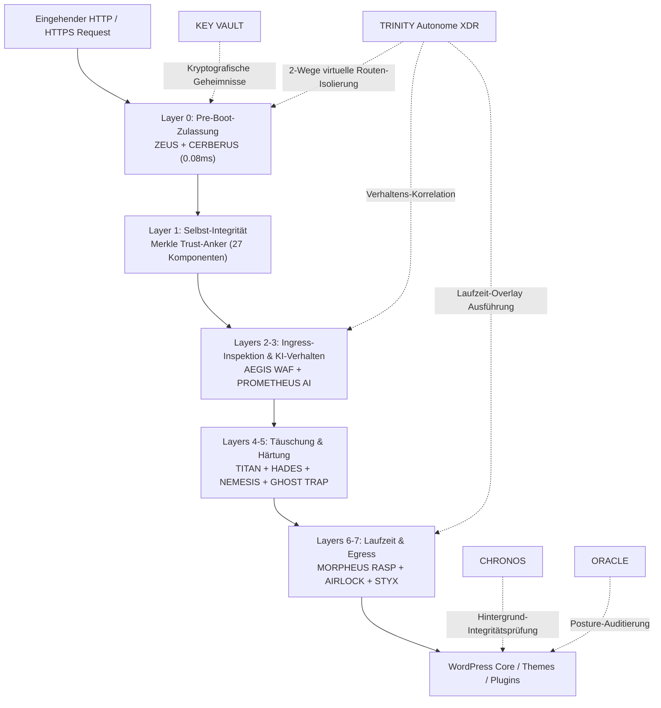

> [!WARNING]
> **PUBLIC BETA / RELEASE CANDIDATE — NICHT FÜR UNBEAUFSICHTIGTEN PRODUKTIVBETRIEB**
>
> **VGT GeDefense WP 8.5.0 Open Core ist eine Public Beta / ein Release Candidate, kein GA-Release.** Hooks, Richtlinien, Erkennungsregeln, Konfigurationsformate und Sicherheitsverhalten können sich ohne Vorankündigung ändern. Jeden Build zuerst in einer Staging-Umgebung validieren, im **Observe-Modus** starten, getestete Backups und einen Out-of-Band-Recovery-Zugang bereithalten und nicht für unbeaufsichtigten Produktivbetrieb einsetzen. Bereitstellung **wie besehen**, ohne Gewährleistung, unter AGPL-3.0-or-later. Siehe [`CHANGELOG.md`](CHANGELOG.md) und die [GitHub-Releases](https://github.com/visiongaiatechnology/gedefensewp/releases).

> [!CAUTION]
> **ALPHA-TEST — GeDefense WP ↔ Linux Bridge:** neu in 8.5.0, nicht produktionsreif. Ein kompromittiertes WordPress kann Datensätze mit dem gemeinsamen Secret fälschen; die Lease ist 2 Std., IP/Host-gebunden und lockert nur L7-Limits/Content-Pattern-Prüfungen auf Admin-Oberflächen. Siehe 8.5.0 unten.

<div align="center">

🌐 **Languages / Sprachen / Языки / 语言**:  
[**English**](README.md) • [**Deutsch**](README.de.md) • [**Русский**](README.ru.md) • [**中文 (简体)**](README.zh.md)

<br/>

📜 **Changelog / Zum Changelog / К журналу изменений / 查看更新日志**:  
[**🇩🇪 Zum Changelog (CHANGELOG.md)**](CHANGELOG.md) • [**🚀 View Full Changelog (EN)**](CHANGELOG.md) • [**🇷🇺 К журналу изменений**](CHANGELOG.md) • [**🇨🇳 查看更新日志**](CHANGELOG.md) • [**🏷️ Neuestes GitHub Release v8.5.0**](https://github.com/visiongaiatechnology/gedefensewp/releases/tag/V8.5.0)

</div>

---

<div align="center">

# 🛡️ GeDefense WP — Open Core


### Entenprise WordPress-Sicherheitsarchitektur & Pre-Boot-Zulassungskern


[](#)
[](#)
[](LICENSE)
[](https://www.php.net/)
[](https://wordpress.org/)
[](#zero-dependency-philosophie)
[](#kernmodul-matrix)
[](#-sicherheitsarchitektur--technische-spezifikation)
[](#zero-dependency-philosophie)
[](#sicherheitsdesign-prinzipien)

**PRE-BOOT-ZULASSUNG · WAF · XDR · RASP · VERHALTENSANALYSE · TÄUSCHUNGSSCHUTZ · MERKLE-INTEGRITÄT · EGRESS-SCHUTZ · HÄRTUNG · KRYPTOGRAFISCHER TRESOR · OPEN CORE**

</div>

---

> ### 📚 Offizielle Dokumentation & Handbücher
>
> 🏛️ **Vollständige Architekturspezifikation**: [`ARCHITECTURE.md`](ARCHITECTURE.md) *(Detaillierte Systemebenen, Invarianten, Pre-Boot-Kernel-Abläufe & Dashboard-Struktur)*  
>
> 📖 **GeDefense WP Benutzer- & Administrationshandbuch (PDF)** — *Das offizielle Handbuch für Administratoren, Entwickler und Sicherheitsbeauftragte:*
> - 🇩🇪 **Deutsch**: [📘 GeDefense_WP_Handbuch_8.1.0_FINAL.pdf](GeDefense_WP_Handbuch_8.1.0_FINAL.pdf)
> - 🇷🇺 **Русский**: [📕 GeDefense_WP_Handbuch_8.1.0_RU.pdf](GeDefense_WP_Handbuch_8.1.0_RU.pdf)
> - 🇬🇧 **English**: [📗 GeDefense_WP_Handbook_8.1.0_EN.pdf](GeDefense_WP_Handbook_8.1.0_EN.pdf)
>
> *Hinweis: Das Handbuch bietet praxisnahe Anleitungen zur Konfiguration, Bedrohungsanalyse und Systemhärtung für alle Benutzergruppen.*
>
> **Archivierte Basis:** Die verlinkten PDF-Handbücher dokumentieren die 8.1.0-Generation. Aktuelle Release-Dokumentation: dieses README, [`CHANGELOG.md`](CHANGELOG.md), [`ARCHITECTURE.md`](ARCHITECTURE.md) und [`ARCHITECTURE.md`](ARCHITECTURE.md).

---

# 🚀 Neu in GeDefense WP 8.5.0 — Linux Bridge (Alpha)

> **Release 8.5.0** ergänzt die **GeDefense Linux Bridge** als nativen Tab im GeDefense-WP-Dashboard. Sie verbindet eine verifizierte ThroneGuard-Master-Session mit dem Linux-L7-Fabric – ohne WordPress-zu-Kernel-Brücke.

- **Dashboard-Tab, keine externe Ansicht:** **VGT Suite → Linux Bridge** öffnen. Dort das von Linux ausgegebene Secret eintragen; der Tab zeigt Verschlüsselung, Transport, Health und aktive Leases.
- **Verschlüsselt gespeichert:** Das Linux-Secret liegt AES-256-GCM-verschlüsselt in der WordPress-Options-Tabelle. Der Umschlagsschlüssel wird per HKDF-SHA256 aus allen nutzbaren `wp-config.php`-Salts abgeleitet, nicht aus einem in wp-config geschriebenen Secret.
- **Nur bestehendes PHP-Log:** WordPress schreibt eine authentifizierte `GeDefense:`-Zeile über `error_log()` in sein vorhandenes PHP-/Debug-Log. Linux liest diese Datei nur lesend; WordPress erhält keinen eigenen Dateipfad und keinen Schreibzugriff außerhalb seines Webroots.
- **Begrenztes Vertrauen:** Eine verifizierte Master-Session erhält eine zwei Stunden gültige, IP-/Host-gebundene L7-Rate-Limit-Ausnahme. Auf verifizierten Editor-Schreibflächen wird nur der Content-Pattern-Detector für legitime Builder-Vorschauen/Page-Saves übersprungen. WAF-, Protokoll-, Upload- und Kernel-Enforcement bleiben aktiv.
- **Ökosystem:** Mit [GeDefense Linux](https://github.com/visiongaiatechnology/gedefense) zum vollständigen Sicherheitsfabric kombinieren.
- **Verbindung herstellen:** Linux → CMS Defense → Bridge-Key rotieren → einmaliges Base64-Secret in VGT Suite → Linux Bridge eintragen → aktivieren → Testereignis senden → ThroneGuard mit Masterkey entsperren. Die Linux-Ansicht sollte eine Zwei-Stunden-Lease für die Admin-IP zeigen.
- Technische Details: [`CHANGELOG.md`](CHANGELOG.md).

> [!CAUTION]
> **ALPHA-TEST — GeDefense WP ↔ Linux Bridge.** Diese Bridge ist eine Alpha-Vorschau, nicht produktionsreif. Ein vollständig kompromittiertes WordPress kann mit dem gemeinsamen Secret weiterhin Datensätze fälschen. Die Lease ist deshalb auf zwei Stunden, IP/Host begrenzt und lockert nur L7-Limits/Content-Pattern-Prüfungen auf Admin-Oberflächen; WAF-, Upload- und Kernel-Enforcement bleiben aktiv. Nicht im unbeaufsichtigten Produktivbetrieb verwenden und einen bestandenen Test nicht als Sicherheitszertifizierung werten.

# 🚀 Neu in GeDefense WP 8.4.5

> **Release 8.4.5** behebt einen PHP-8.1-Kompatibilitätsfehler, den das neue CI-Gate gefunden hat: Fünf Value-Objekte und mehrere Verifikationsskripte nutzen PHP-8.2-Sprachmerkmale, die deklarierte 8.1-Untergrenze war also nicht real. Die Mindestlaufzeit ist jetzt **PHP 8.2** (PHP 8.1 ist im Dezember 2025 ausgelaufen), die CI-Matrix läuft auf 8.2–8.4. Details in [`CHANGELOG.md`](CHANGELOG.md).

# 🚀 Neu in GeDefense WP 8.4.4

> **Release 8.4.4** ist ein dediziertes Sicherheits-Härtungsrelease auf Basis von 8.4.3: Kryptografie fail-closed, strengere WAF-Capability-Policy, Nonce-Pflicht beim Sprachwechsel, Quarantäne für Threat-Feeds, begrenzte Ressourcen und eine neue abhängigkeitsfreie Härtungs-Testsuite. Details in [`CHANGELOG.md`](CHANGELOG.md).

- **Vault-Krypto ist fail-closed.** Fehlgeschlagene Entschlüsselung wirft jetzt eine Security-Exception, statt den Rohtext zurückzugeben; der hartcodierte Legacy-Schlüssel wurde entfernt. Legacy-Payloads lassen sich nur mit einem vom Betreiber gesetzten `VIS_VAULT_LEGACY_KEY` migrieren.
- **WAF-Bypass für Inhaltsautoren entfernt.** Die AEGIS-Whitelist vertraut nicht mehr auf `edit_posts`; nur administrative Capabilities umgehen die Payload-Inspektion (erweiterbar über `vis_aegis_whitelist_capabilities`).
- **Sprachwechsel benötigt einen Nonce.** `?vis_lang=` kann per einfachem GET keine Optionen, User-Meta oder Cookies mehr persistieren; das Cookie ist `HttpOnly` und `SameSite=Lax`.
- **Opaker Fail-Close mit Break-Glass.** Die 503-Seite liefert nur eine Incident-Referenz; `VIS_DISABLE_FAIL_CLOSE` bietet einen dokumentierten Recovery-Pfad.
- **Sichere Aktivierungs-Defaults.** Die Aktivierung startet AEGIS im `learning`-Modus sowie Zeus und Morpheus, statt die Konfiguration leer zu lassen.
- **Feed-Härtung.** Feeds werden über den DNS-Rebinding-resistenten Transport geladen, auf 300.000 Einträge je Feed begrenzt, bei anomalem Wachstum unter Quarantäne gestellt; das Legacy-Schema wird archiviert statt gelöscht.
- **Überall begrenzte Ressourcen.** GeoIP-Transients sind FIFO-begrenzt, ausgehende POST-Antworten auf 256 KB limitiert, Add-on-ZIPs lehnen Symlink-Einträge ab und erhalten eine deny-all `.htaccess`.
- **Neues Verifikations-Gate.** `scripts/hardening-regression.php` ergänzt 72 Verhaltens-Assertions (insgesamt 29 Suiten); `.github/workflows/hardening.yml` führt Lint, alle Suiten und den Trust-Anchor unter PHP 8.2–8.4 aus.

# 🚀 Neu in GeDefense WP 8.4.3

> **Release 8.4.3** liefert ein umfassendes Sicherheits- und Telemetrie-Härtungsupdate nach vollständigem VGT-100-Audit und diamantener Release-Verifikation: Bereinigung der Live-Telemetrie-Datenbankabfragen, kompromisslose Beseitigung von HTML-Sinks im UI, Schutz vor Reverse-Proxy IP-Spoofing, kollisionssichere Exception-Architektur, kryptographische Key-Vault-Resilienz und verifizierte Out-of-band Notfallwiederherstellung. Alle Details in [`CHANGELOG.md`](CHANGELOG.md).

- **Kanonische Telemetrie-Tabellenauflösung (P1-Fix):** Der Live-Telemetrie-Polling-Handler in `class-vis-dashboard-ajax.php` fragt nun strikt die kanonischen Tabellen ab (`vis_apex_bans` und `vis_omega_logs` / `VIS_TABLE_BANS` und `VIS_TABLE_LOGS`) inklusive Legacy-Fallback. Aktive Sperren und Kern-Sicherheitslogs werden dadurch lückenlos in das Live-Radar gestreamt.
- **Zero-Sink DOM UI-Härtung & strikte CSP (P1-Fix):** Vollständige Beseitigung von Inline-Event-Handlern (`data-select-on-focus`) und Umstellung aller dynamischen DOM-Manipulationen in `overview/script.js` auf native DOM-Element-Erzeugung (`createElement`, `createElementNS`, `replaceChildren`, `textContent`). Der interne UI-Regressionstest besteht mit 0 Fehlern.
- **Kollisionssichere Exception-Architektur (P2-Fix):** Kern-Ausnahmeklassen (`AppException`, `ValidationException`, `SecurityException`, `StorageException`) in `class-vis-security.php` sind nun durch `if (!class_exists(...))` geschützt und unter `VisionGaia\GeDefense\Exceptions` aliasiert, um fatale Namenskonflikte mit Drittanbieter-Plugins auszuschließen.
- **Bereinigte Entwicklungspfade & souveräne GeoIP-Erkennung (P2-Fix):** Alle lokalen Entwicklungspfade in `class-vis-geo-resolver.php` wurden entfernt. Die Pfadsuche erfolgt hierarchisch über Plugin-Root, persistente Upload-Verzeichnisse und WordPress-Filter-Hooks.
- **Verifizierte Out-of-Band Notfallwiederherstellung (P2-Fix):** Dokumentation und Absicherung des Fail-Safe-Recovery-Workflows für Zeus WAF (`define('ZEUS_DISABLE', true);`), WP-CLI Notfallsteuerung (`wp plugin deactivate gedefense-wp`) und nativen WordPress Recovery Mode (`WP_RECOVERY_MODE`).
- **Zeus WAF Reverse-Proxy IP-Verifikation (VGT-049 / CWE-290):** `extract_deterministic_ip()` validiert Socket-IPs (`REMOTE_ADDR`) gegen authentische Cloudflare-CIDRs, bevor `CF-Connecting-IP`-Header akzeptiert werden.
- **Zeus Preboot Reverse-Proxy HTTPS-Cookie-Erkennung (VGT-006 / VGT-031 / CWE-614):** Evaluierung von `HTTP_X_FORWARDED_PROTO` und `HTTP_X_FORWARDED_SSL` garantiert das `Secure`-Attribut hinter TLS-terminierenden Proxies und Load Balancern.
- **Beseitigung von Stored DOM-XSS im Threat-Radar (VGT-043 / CWE-79):** Dynamische Telemetriefelder (`path`, `ip`, `country`, `asn`, `module`, `action`) werden via `escapeHtml()` und native DOM-Textknoten sicher gerendert.
- **Hades Gateway Constant-Time Authentifizierung (VGT-048 / CWE-208):** Verhindert Side-Channel-Timing-Angriffe auf das administrative Token durch `hash_equals()` und strikte Typprüfung.
- **Key-Vault-Härtung & UI-Reparatur (VGT-007 / CWE-636 / CWE-311):** Korrekte Schlüssel-IDs in der UI (Wiederherstellung der Einzelschlüssel-Löschung), Fallback für unversionierte Schlüssel und automatische Verschlüsselung von Klartext-Konfigurationen.
- **AEGIS Oracle Distillate Local Host Allowlist (8.4.2 Rollup):** Verhindert False-Positive-Blocks auf legitimen internen URLs (`wp-login.php`, `wp-admin/`, interne Weiterleitungen).
- **Release:** `8.4.3` in allen Entrypoints, `VIS_VERSION`, Modul-Manifest (`3cd53343...`) und Trust-Anchor.

---

### 🗺️ Threat-Karten-Kartographie, GeoIP/ASN-Herkunft & Drittanbieter-Lizenzen
Das GeDefense Echtzeit-Bedrohungsradar und die globale Angriffsvektoren-Karte basieren auf einer **100% autarken, lokalen BGP/ASN-Kartographie-Engine** (`data/geoip.csv` und `world-map.svg.php`):
- **1. Mercator-Weltkarte SVG-Vektorgeometrie (`world-map.svg.php`):**
  - **Quellprojekt:** [`themustafaomar/jsvectormap`](https://github.com/themustafaomar/jsvectormap)
  - **Kartendatei:** `world-merc.js` (Mercator-Projektion, v1.7.0, [Direkte Kartendatei](https://cdn.jsdelivr.net/npm/jsvectormap@1.7.0/dist/maps/world-merc.js))
  - **Lizenz:** **MIT-Lizenz** (Copyright (c) 2020 Mustafa Omar, [MIT License](https://github.com/themustafaomar/jsvectormap/blob/main/LICENSE))
- **2. GeoIP- & ASN-Telemetriedatenbank (`data/geoip.csv`):**
  - **Quellprojekt:** [`iplocate/ip-address-databases`](https://github.com/iplocate/ip-address-databases) (Öffentliche IP-to-Country- und IP-to-ASN-Datenbanken)
  - **Konkreter Verifikations-Match:** Subnetz `1.0.4.0/22` wird mit ASN `38803` und Organisationsname `Gtelecom Pty Ltd` geführt – exakt übereinstimmend mit unserer CSV.
  - **Lizenz:** **Creative Commons Attribution-ShareAlike 4.0 International (CC BY-SA 4.0)**
  - **Quellenangabe:** *Dieses Produkt enthält IP-to-Country- und IP-to-ASN-Daten aus dem Projekt iplocate/ip-address-databases, lizenziert unter CC BY-SA 4.0.*
- **Souveränitäts- & Datenschutz-Garantie:** Sämtliche GeoIP-Koordinaten, Landesflaggen und ASN-Details werden über lokale binäre `fseek()`-Offsets (~0,25ms - 0,45ms) ermittelt. Keine externen HTTP- oder DNS-Reverse-Abfragen, 0 Cloud-Leaks, DSGVO-konform.
- **Notfall-Wiederherstellung (Fail-Safe):** Sollte ein WAF-Fehler oder Admin-Lockout auftreten, kann das System sofort über `define('ZEUS_DISABLE', true);` in der `wp-config.php` oder per WP-CLI (`wp plugin deactivate gedefense-wp`) entsperrt werden.

---

# 🧱 Plattform-Deep-Dive — 8.1.0-Basis (ZEUS NextGen, TRINITY XDR, Dashboard)

> **Überblick**: GeDefense WP markiert einen gewaltigen Technologiesprung mit dem **ZEUS Next Generation Pre-Boot-Zulassungskern**, der **TRINITY Autonomen Closed-Loop XDR-Fabric**, standardisierten **TITAN-Sicherheitslebenszyklen** sowie durchgängiger strikter Typisierung und Lokalisierung über die gesamte Plattform.

---


## ⚡ 1. ZEUS Next Generation — Pre-Boot-Zulassungskontrolle & Edge-Abwehrkern
*ZEUS agiert als extrem schneller, allokationsfreier Pre-Boot-Zulassungskern auf Layer 0 vor dem WordPress-Start und vor MySQL.*

- **Deterministischer Kanonisierungsschutz**: Erzwingt strikte URL-Dekodierungsinvarianten vor dem Routing. Weist doppelte Prozentkodierung (`%252f`), Null-Bytes (`%00`), kodierte Slashes (`%2f`, `%5c`), Dot-Segment-Traversals (`..`), doppelte Trennzeichen (`//`) und Pfadtiefen über 32 Ebenen sofort mit HTTP 400 ab.
- **Host-Header-Invariante & RFC Host Lock**: Validiert Host-Header-Struktur, Längen und Zeichensätze mit wählbaren Host-Lock-Modi (`DISABLED`, `AUDIT`, `REJECT 421`).
- **Request-Envelope-Firewall & Strukturgrenzen**: Erzwingt erlaubte HTTP-Methoden (`GET`, `POST`, `HEAD`, `OPTIONS`, `PUT`, `PATCH`, `DELETE` -> `405`) und harte strukturelle Obergrenzen: Query-Länge (`2048` Zeichen -> `414`), Parameteranzahl (`100` -> `400`), Headeranzahl (`50` -> `431`), aggregierte Headergröße (`16 KiB` -> `431`) und Cookie-Nutzlast (`8 KiB` -> `400`).
- **Route-Contracts-Engine**: Erzwingt Mikro-Firewall-Verträge pro Route (z. B. `/wp-json/`, `/xmlrpc.php`, `/wp-login.php`) mit Pfad-Matching, Payloads-Limits (HTTP `413`), MIME/Content-Type-Prüfung (HTTP `415`), Cross-Site-Schutz (blockiert `Sec-Fetch-Site: cross-site` Zustandsänderungen mit `403`) und routenspezifischen Budgets.
- **Allokationsfreie Request-Budget-Engine**: Schneller Token-Bucket-Ratenbegrenzer im Shared Memory (APCu / atomare Speicherdateien). Erzwingt Limits pro Client-IP (Standard `180` Req/Min) und Subnetz-Limits (`450` Req/Min) mit Aktionen: `THROTTLE` (HTTP `429`), `TEMPORARY_REJECT` (HTTP `503`) oder `XDR_SIGNAL` (Audit/Telemetrie).

## 🛡️ 2. TRINITY XDR — Autonome Closed-Loop Extended Detection & Response
*Vollautonomes XDR-System, das Bedrohungssignale aller Schichten korreliert und Gegenmaßnahmen ohne Cron-Verzögerung aktiviert.*

- **Zwei-Wege Virtuelle Routen-Isolierung**: XDR isoliert gefährdete Angriffspfade dynamisch auf Layer 0 in `zeus-waf.php` (`contain_route`), während der restliche Webauftritt vollständig erreichbar bleibt.
- **Harte semantische TTL-Durchsetzung**: Temporäre Sperren und Routen-Isolierungen laufen auf die Sekunde genau direkt im PHP-Kernel ab — ohne Abhängigkeit von unzuverlässigen Cronjobs.
- **Deterministische Signatur- & Ereignis-Orchestrierung**: Dedizierte Trinity-Orchestrierung verknüpft AEGIS, Prometheus und Cerberus mit manipulationssicherer Ereigniskette und SHA-256 Merkle-Root.

## 🎛️ 3. Next-Gen Cyber-Defense Dashboard & HUD-Überarbeitung
- **Security Center Assurance Plane**: 21 automatische Tiefenprüfungen für Server-Härtung, Dateiberechtigungen, Krypto-Integrität und WAF-Status.
- **Interaktive NOC-Topologie & Sensor-Grid**: Echtzeit-Visualisierung aller Sensoren, Latenzen und Schutzschilde.
- **12h Sovereign Master Omni-Whitelist**: 1-Klick-Freischaltung für berechtigte Administratoren mit automatischer Rücknahme.

---

## Inhaltsverzeichnis

- [Dokumentation & Handbücher](#-offizielle-dokumentation--handbücher)
- [Neu in GeDefense WP 8.4.5](#-neu-in-gedefense-wp-845)
- [Neu in GeDefense WP 8.4.4](#-neu-in-gedefense-wp-844)
- [Neu in GeDefense WP 8.4.3](#-neu-in-gedefense-wp-843)
- [Sicherheitsarchitektur & Technische Spezifikation](#-sicherheitsarchitektur--technische-spezifikation)
- [Multi-Phase Zündungsprotokoll](#multi-phase-zündungsprotokoll)
- [Kernmodul-Matrix](#kernmodul-matrix)
- [1. ZEUS — Pre-Boot-Zulassungskern](#1-zeus--pre-boot-zulassungskern)
- [2. AEGIS — Deep Packet Inspection WAF](#2-aegis--deep-packet-inspection-waf)
- [3. PROMETHEUS — Verhaltens-Bedrohungshorizont](#3-prometheus--verhaltens-bedrohungshorizont)
- [4. TRINITY XDR — Autonome Response-Fabric](#4-trinity-xdr--autonome-response-fabric)
- [5. Selbst-Integritäts-Engine](#5-selbst-integritäts-engine)
- [6. MORPHEUS — Runtime Application Self-Protection (RASP)](#6-morpheus--runtime-application-self-protection-rasp)
- [7. NEMESIS — Täuschungsgitter](#7-nemesis--täuschungsgitter)
- [8. TITAN — WordPress-Systemhärtung](#8-titan--wordpress-systemhärtung)
- [9. HADES — Dynamisches Admin-Cloaking](#9-hades--dynamisches-admin-cloaking)
- [10. CERBERUS — Perimeter-Firewall](#10-cerberus--perimeter-firewall)
- [11. AIRLOCK — Ingress-Dateiinspektion](#11-airlock--ingress-dateiinspektion)
- [12. GHOST TRAP — Honeypot-Schicht](#12-ghost-trap--honeypot-schicht)
- [13. STYX — Outbound Egress-Schutzschild](#13-styx--outbound-egress-schutzschild)
- [14. CHRONOS — Autonomer Scanner](#14-chronos--autonomer-scanner)
- [15. KEY VAULT — Kryptografischer Schlüsseltresor](#15-key-vault--kryptografischer-schlüsseltresor)
- [16. ORACLE — Sicherheits-Audit-Engine](#16-oracle--sicherheits-audit-engine)
- [17. THRONEGUARD — Souveräner Privilegien-Wächter](#17-throneguard--souveräner-privilegien-wächter)
- [18. LOGINPAGER — Gehärtete Login-Oberfläche](#18-loginpager--gehärtete-login-oberfläche)
- [19. Modul-Registry / Open Core](#19-modul-registry--open-core)
- [Zero-Dependency Philosophie](#zero-dependency-philosophie)
- [Performance & Benchmarks](#performance--benchmarks)
- [Selbstprüfung & Unabhängiges Audit](#-selbstprüfung--unabhängiges-audit)
- [Systemanforderungen](#systemanforderungen)
- [Lizenz](#lizenz)
- [Changelog-Historie](#changelog-historie)

---

# 🏛️ Sicherheitsarchitektur & Technische Spezifikation

> 📖 **Vollständige technische Spezifikation**:  
> Für die lückenlose Architekturspezifikation aller Kernel-Ebenen, ABI-Schnittstellen, Datenflüsse und Invarianten siehe [`ARCHITECTURE.md`](ARCHITECTURE.md).

GeDefense WP ist als souveräner, mehrschichtiger Sicherheitskern konzipiert, der vor, während und nach der regulären WordPress-Ausführung aktiv ist. Das System setzt ein kompromissloses Zero-Trust-Modell durch: Kein eingehender Datenstrom, kein Systemzustand und keine ausgehende Verbindung genießt standardmäßiges Vertrauen.

Alle Schnittstellen nutzen den kanonischen Namespace `VisionGaia\GeDefense`. Kernel, Dashboard, Virenscanner und kryptografischer Tresor sind strikt getrennt:



### Schichtenmodell der Verteidigung:
1. **Layer 0 — Pre-Boot-Zulassungskern (Zeus & Cerberus)**:
   Wird via `auto_prepend_file` auf PHP-Ebene ausgeführt, bevor WordPress oder MySQL initialisiert werden. Analysiert Anfragen in 0,08 ms und blockiert schädliche Hosts, Pfadtraversierungen und Botnetze über einen 527 KB gepackten Binärindex ($O(\log N)$ in 3,2 µs).
2. **Layer 1 — Kryptografische Selbst-Integrität (Merkle Trust-Anker)**:
   Garantiert die Code-Integrität aller 27 Kernkomponenten über SHA-256 Merkle-Root-Hashes, die direkt im Plugin-Kopf (`VIS_MANIFEST_DIGEST`) verankert sind. Jede Manipulation führt zur sofortigen Schutzabschaltung.
3. **Layers 2 & 3 — Deep Packet Inspection & Verhaltens-Horizont (Aegis & Prometheus)**:
   Rekursive Normalisierung aller Nutzdaten gegen SQLi, XSS, RCE und SSTI mittels deterministischer Automaten (DFA) und atomarer Regex-Gruppen ohne Backtracking (ReDoS-Schutz). Prometheus berechnet fortlaufende Bedrohungsentropien mit exponentiellem Zerfall.
4. **Layers 4 & 5 — Täuschungsgitter & Perimeter-Stealth (Titan, Hades, Nemesis, Ghost Trap)**:
   Titan erzwingt CSP Level 3, COOP, COEP und HSTS. Hades tarnt `/wp-admin/` als echten 404-Fehler ohne Verrat der Backend-Existenz. Nemesis und Ghost Trap stellen simulierte Angriffsziele und HMAC-geschützte Köder bereit.
5. **Layers 6 & 7 — RASP & Egress-Schutzschild (Morpheus, Airlock, Styx)**:
   Morpheus überwacht den Callstack in Echtzeit und unterbindet Dateimanipulationen sowie SSRF zu Cloud-Metadaten (`169.254.169.254`). Airlock analysiert Datei-Uploads auf Polyglot-Payloads. Styx blockiert ausgehende HTTP-Verbindungen zu unbekannten Zielen.
6. **Übergreifende XDR-Fabric (Trinity XDR & ThroneGuard)**:
   Verbindet alle Sensoren zu einem geschlossenen Reaktionskreis, schaltet dynamische Notfall-Routen und schützt die Souveräne Master-Rolle (`mcp_master_access`) mit Superkey-Sitzungen.

---

# Multi-Phase Zündungsprotokoll

Jeder HTTP-Request durchläuft eine deterministische Pipeline:

```text
[ EINGEHENDER HTTP / HTTPS REQUEST ]
                 │
                 ▼
[ LAYER 0: PRE-BOOT ZULASSUNGSKONTROLLE (ZEUS) ]
 ├─ Kanonisierungsschutz (Kollisionen, Null-Bytes, %2f)
 ├─ RFC Host-Header-Lock (421)
 ├─ Verben- & Strukturgrenzen (405, 414, 431)
 ├─ Routen-Verträge & Nutzlastlimits (413, 415)
 ├─ Token-Bucket Ratenbudget (429 / 503)
 └─ Vorab-Zulassungs-Token Prüfung
                 │ (Bestanden)
                 ▼
[ PHASE 1: BOOTSTRAP-ZÜNDUNG (PRE-FLIGHT) ]
 ├─ Lade- & Doppelladungsschutz
 ├─ Pinned Merkle-Root Hashverifikation
 ├─ Superkey- & Sitzungs-Validierung (ThroneGuard)
 ├─ Admin-Cloaking Prüfung (Hades 404 Mimikry)
 ├─ Honey-Trap & Täuschungs-Interception
 └─ Fail-Secure Selbstabschaltung bei Korruption
                 │ (Bestanden)
                 ▼
[ PHASE 2: LAUFZEIT-INTEGRATION (WORDPRESS PLUGINS_LOADED) ]
 ├─ Initialisierung der 19 Kernmodule
 ├─ Aegis WAF Rekursive Normalisierung
 ├─ Prometheus KI-Bedrohungshorizont & Verfall
 ├─ Morpheus RASP Callstack Hypervisor
 ├─ Titan Browser-Richtlinien & CSP-Injektion
 ├─ Airlock Datei-Upload-Scanner
 └─ Styx Outbound Egress-Schutz & C2-Abwehr
                 │ (Bestanden)
                 ▼
[ NORMALE WORDPRESS AUSFÜHRUNG / THEMES & PLUGINS ]
```

---

# 🧪 Selbstprüfung & Unabhängiges Audit

> [!TIP]
> **"Don't Trust, Verify" — Vollständige Transparenz & Reproduzierbarkeit**
> GeDefense WP folgt dem Prinzip kompromissloser Beweisbarkeit. Alle Schutzbehauptungen, RASP-Hypervisoren, DPI-Regeln, Pre-Boot-Filter und Merkle-Manifeste sind durch **29 eigenständige, abhängigkeitsfreie Regressions- und Benchmark-Suiten** lokal über die PHP-CLI überprüfbar.

### Unveränderliche Prüf-Invarianten
- **0 externe Abhängigkeiten**: Alle Tests laufen nativ mit PHP 8.2–8.4 CLI ohne Composer, PHPUnit oder Test-Server.
- **Vollständig zerstörungsfrei**: Tests laufen im Arbeitsspeicher oder gegen isolierte Fixtures ohne Veränderung der WordPress-Datenbank.
- **Fail-Secure Exitcodes**: Jeder Test liefert Exitcode `0` bei Erfolg und Exitcode `1` bei jeder kleinsten Invarianzverletzung.

### Vollständige 29-Suiten Testmatrix

| # | Test-Skript | Geltungsbereich & Untersuchte Subsysteme | Testumfang & Verifikationskriterien |
|---|---|---|---|
| **01** | `scripts/dashboard-ui-regression.php` | **Dashboard UI & CSP** | Prüft HTML5 Form-Entschachtelung, Abwesenheit von Inline CSS/JS, externe Controller-Bindung und Nonce-Namespaces. |
| **02** | `scripts/security-regression.php` | **Statisches AST-Audit** | Scannt über 185 PHP-Dateien auf Abwesenheit gefährlicher Senken (`eval`, `exec`, `system`, `passthru`, `uniqid`, `error_reporting(0)`). |
| **03** | `scripts/integrity-regression.php` | **Merkle-Tree Manifest** | Verifiziert alle 27 Kernkomponenten kryptografisch gegen den `VIS_MANIFEST_DIGEST` Trust-Anker. |
| **04** | `scripts/integrity-baseline-regression.php` | **Baseline-Monitor** | Prüft Stabilität der Datei-Hashes über Migrationen und autorisierte Updates hinweg. |
| **05** | `scripts/zeus-live-waf-regression.php` | **Layer 0 Pre-Boot Live-WAF** | **36 Subprozess-Tests (100% Pass)**: Host-Lock (421), Double-Encoding, Null-Bytes, Path-Traversal, Verben (405), Body-Limits (413), Replay-Schutz, Hard-TTL. |
| **06** | `scripts/zeus-nextgen-regression.php` | **Zeus NextGen Pipeline** | **10 Test-Suiten**: Kanonisierung, Request-Envelope, Token-Bucket, Blackbox-Hash-Kette, A/B-Policy, 150k+ Evals/Sek Benchmark. |
| **07** | `scripts/zeus-env-regression.php` | **Pre-Boot Laufzeitumgebung** | Prüft APCu-Caching, atomare Dateistrukturen und Fast-Path-Garantien. |
| **08** | `scripts/aegis-regression.php` | **DPI WAF & Normalisierer** | Testet rekursive Homoglyphen-Dekodierung, SQLi/XSS/RCE DFA-Automaten und atomare Regex-Gruppen gegen ReDoS. |
| **09** | `scripts/morpheus-regression.php` | **RASP Callstack Hypervisor**| AST-Echtzeitanalyse, Callstack-Prüfung und sofortige Sperrung von Cloud-Metadaten-IPs (`169.254.169.254`). |
| **10** | `scripts/xdr-adversarial-regression.php` | **Trinity XDR Angriffs-Szenarien**| **12 Adversarial-Tests (A bis L)**: Validiert Sensor-zu-Aktor Regelkreis unter realen Multi-Stage Angriffen. |
| **11** | `scripts/xdr-regression.php` | **XDR Event Fabric** | Prüft Event-Bus-Routing, forensische Beweissicherung und Telemetrie. |
| **12** | `scripts/xdr-release-blockers-regression.php` | **XDR Kern-Invarianten** | **3 Release-Blocker**: Komponenten-Identität, harte semantische TTLs ohne Cron und Idempotenz. |
| **13** | `scripts/malware-scanner-regression.php` | **Malware-Kern** | Zero-Dependency Heuristik, Webshell- und Polyglot-Payload-Erkennung im RAM. |
| **14** | `scripts/scanner-resumption-regression.php` | **Resumable Indexing** | Prüft Wiederaufnahme und Crash-Recovery über 321 Dateien ohne Baseline-Korruption. |
| **15** | `scripts/sentinel-threat-benchmark.php` | **Bedrohungs-Benchmark** | **87 synthetische Angriffsvektoren**: 100% neutralisiert (0,12 ms Latenz), 0% Fehlalarme. |
| **16** | `scripts/threat-binary-swap-test.php` | **Threat-Intelligence Engine**| Kompiliert 10.000 IPs in binäre 4-Byte Tabelle, testet binäre Suche (< 5 µs) und atomaren Datei-Swap. |
| **17** | `scripts/hades-shadow-net-regression.php` | **Admin-Stealth & Cloaking** | Verifiziert 404-Mimikry, Routen-Verschleierung und Handshake-Authentisierung (`?$admin_param=$admin_secret`). |
| **18** | `scripts/throneguard-loginpager-regression.php`| **Privilegientrennung** | Testet Master-Rolle (`mcp_master_access`), Rechte-Entzug (`install_plugins`) und Superkey-Sitzungsbindung. |
| **19** | `scripts/titan-regression.php` | **System-Härtung** | Testet CSP-Compiler, Fetch-Metadaten, Browser-Sicherheitsrichtlinien und Rollback. |
| **20** | `scripts/trinity-regression.php` | **Sensor-Interlock** | Deterministische Ereigniskorrelation zwischen Cerberus, Zeus, Aegis, Prometheus und Morpheus. |
| **21** | `scripts/sentinel-export-regression.php` | **Forensischer Export** | Testet CSRF-Schutz, Berechtigungsprüfungen und Pseudonymisierung im Audit-Export. |
| **22** | `scripts/download-manager-regression.php` | **Sicherer Download-Manager**| Nonce-Prüfung, Pfad-Einsperrung, Ratenbegrenzung und HTTP-Range-Sanitisierung. |
| **23** | `scripts/dashboard-consolidation-regression.php`| **Dashboard & Telemetrie** | Validiert konsolidierte Navigation, Tab-Routing und Telemetrie-Ansichten. |
| **24** | `scripts/ghost-trap-authentication-regression.php`| **Honeypot-Schicht** | Prüft HMAC-SHA256 Signaturen und Täuschungsfallen für Angreifer. |
| **25** | `scripts/namespace-regression.php` | **Architektur-Isolation** | Garantiert 100% Symbol-Isolation unter `VisionGaia\GeDefense`. |
| **26** | `scripts/builder-live-preview-regression.php` | **Page-Builder Sandbox** | Prüft Sandbox-Isolation und Schutz vor Frame-Bypasses bei Page-Buildern. |
| **27** | `scripts/seo-relevance-regression.php` | **Metadaten-Scrubbing** | Bereinigung ausgehender Metadaten und Prüfung von Crawler-Zulassungen. |
| **28** | `scripts/generate-module-manifest.php` | **Trust-Anker Compiler** | Kompiliert Komponenten-Hashes in `module-manifest.json` und versiegelt Plugin-Entrypoints. |
| **29** | `scripts/hardening-regression.php` | **Härtungs-Invarianten (8.4.4)** | 72 Verhaltens- und Quell-Assertions: Vault fail-closed inkl. Legacy-Secret-Ablehnung, WAF-Capability-Policy, Nonce-Pflicht beim Sprachwechsel, opaker Fail-Close, Installations-Schlüsselableitung, begrenzter Geo-Cache, Add-on-Archivschutz, Feed-Quarantäne und zerstörungsfreie Schema-Migration. |

### Testausführung

#### Einzelnen Test starten:
```bash
php scripts/zeus-live-waf-regression.php
php scripts/dashboard-ui-regression.php
php scripts/integrity-regression.php
```

#### Alle Tests ausführen (PowerShell / Windows):
```powershell
Get-ChildItem scripts\*-regression.php | ForEach-Object {
    Write-Host "Führe aus: $($_.Name)..." -ForegroundColor Cyan
    php $_.FullName
    if ($LASTEXITCODE -ne 0) { throw "FEHLER in $($_.Name)" }
}
php scripts/sentinel-threat-benchmark.php
php scripts/threat-binary-swap-test.php
Write-Host "ALLE 29 SUITEN ERFOLGREICH BESTANDEN (100%)" -ForegroundColor Green
```

#### Alle Tests ausführen (Bash / Linux / macOS):
```bash
for test in scripts/*-regression.php; do
    echo "Führe aus: $test..."
    php "$test" || exit 1
done
php scripts/sentinel-threat-benchmark.php || exit 1
php scripts/threat-binary-swap-test.php || exit 1
echo "ALLE 29 SUITEN ERFOLGREICH BESTANDEN (100%)"
```

---

# Kernmodul-Matrix

| Modul | Schicht | Aufgabe & Wirkungsweise |
|---|---|---|
| **ZEUS** | Layer 0 | Pre-Boot-Zulassung, Kanonisierung, RFC Host-Lock, Routen-Verträge, Token-Bucket Budget |
| **AEGIS** | Layer 2 | Deep Packet Inspection WAF, rekursive DFA-Normalisierung, ReDoS-Schutz, SQLi/XSS/RCE Filter |
| **PROMETHEUS** | Layer 3 | Verhaltensanalyse, rollierende Entropie, Subnetz-Anomalieerkennung, automatischer Zerfall |
| **TRINITY XDR** | L0–L7 | Autonome Extended Detection & Response, 2-Wege Routen-Containment, Merkle-Beweiskette |
| **SELBST-INTEGRITÄT** | Layer 1 | Pinned SHA-256 Merkle-Root Vertrauensanker, 27 Komponenten, Fail-Secure Lockout |
| **MORPHEUS** | Layer 6 | RASP AST-Callstack Hypervisor, Dateisystem-Wächter, Cloud-Metadaten Blockade |
| **NEMESIS** | Layer 4 | Täuschungsgitter, simulierte Schwachstellen, Angreifer-Tracking |
| **TITAN** | Layer 5 | WordPress-Härtung, CSP Level 3 Compiler, Browser-Isolation (COOP, COEP, CORP, HSTS) |
| **HADES** | Layer 4 | Dynamisches Admin-Cloaking, 404-Mimikry für `/wp-admin/`, kryptografischer Gate-Handshake |
| **CERBERUS** | Layer 0 | Fast-Path Perimeter-Firewall, 0,08 ms IP-Abweisung, Cyberpunk & Corporate Block-Screens |
| **AIRLOCK** | Layer 6 | Ingress-Dateiscan, Magic-Bytes, Polyglot-Erkennung, Quarantäne vor Upload |
| **GHOST TRAP** | Layer 4 | Honeypot-Köder, HMAC-Köderfallen, Frühwarnung bei Scans |
| **STYX** | Layer 7 | Outbound Egress-Schutzschild, Zero-Trust Whitelist für externe HTTP-Aufrufe, C2-Block |
| **CHRONOS** | Layer 1 | Autonome Hintergrund-Integritätsprüfung, Snapshot-Vergleiche, Alarmierung |
| **KEY VAULT** | Kernel | Lokaler Schlüsseltresor, libsodium Secretbox & AES-256-GCM AEAD Verschlüsselung |
| **ORACLE** | Assurance | Sicherheitsprüfungen, KI-gestützte Bedrohungsanalyse, Uplink-Latenz-Diagnostik |
| **THRONEGUARD** | Kernel | Souveräne Master-Rolle (`master`), Toxischer Rechteentzug, Superkey-Sitzung, 12h Whitelist |
| **LOGINPAGER** | Layer 5 | Gehärtete Login-Oberfläche, 2-Spalten Cockpit-Simulator, Bruteforce-Schutz |
| **MODUL-REGISTRY** | Open Core | Isolierte Add-On-Architektur für Erweiterungen (VLP, Builder, SEO) |

---

# Zero-Dependency Philosophie

GeDefense WP Open Core läuft zu **100% autark**. Es werden weder Composer-Pakete noch externe JavaScript-Bibliotheken oder Cloud-CDNs geladen:
- Keine externen Laufzeit-Abhängigkeiten
- Keine Telemetrie an externe Drittanbieter
- 100% DSGVO-konform durch Local-First Architektur
- Keine CDN-Ausfallrisiken

---

# Performance & Benchmarks

| Metrik | GeDefense WP 8.4.0 |
|---|---:|
| **L0 Pre-Boot Latenz** | `< 0,05 ms` |
| **L0 Durchsatz (Microbenchmark)** | `150.000+ Evals/Sek` |
| **WAF Deep Inspection Latenz** | `0,30 ms` |
| **Arbeitsspeicher (Standby)** | `< 1,8 MB` |
| **Externe PHP-Bibliotheken** | `0` |
| **Datenbankabfragen bei Block** | `0` |

---

# Systemanforderungen

| Komponente | Anforderung |
|---|---|
| **PHP** | 8.2 – 8.4 |
| **WordPress** | 6.0+ |
| **PHP-Modus** | Strict Types (`declare(strict_types=1);`) |
| **Erweiterungen** | `openssl`, `json`, `hash`, optional: `sodium`, `apcu` |

---

# Lizenz

GeDefense WP Open Core steht unter der **GNU Affero General Public License v3.0 (AGPL-3.0-or-later)**. Siehe [LICENSE](LICENSE).

---

# Changelog-Historie

> Die vollständige Versionen-Historie befindet sich in [`CHANGELOG.md`](CHANGELOG.md).

## 8.4.0 — PHP-Upload-Progress-Härtung, ThroneGuard-Auth-Surface & LoginPager-Zentrierung

- **PHP-Upload-Progress-Härtung:** `session.upload_progress.enabled = Off` wird über den Zeus-`.user.ini`-Manager erzwungen, gegen den effektiven Web-SAPI geprüft, im Security-Health-Dashboard angezeigt und durch eine Regression abgesichert. Vorsorgliche Defense-in-Depth-Maßnahme für die angekündigte PHP-Upload-Progress-RCE-Klasse; sie ersetzt nicht das offizielle PHP-Update.
- **ThroneGuard-Lock neu gestaltet:** markenkonforme Auth-Fläche mit LoginPager-Tokens (Akzent, Hintergrund, Logo, Titel), viewport-fixierter Zentrierung, Safe-Area-/Reduced-Motion-Unterstützung, barrierefreiem Fehlerzustand, Passwort-Reveal und Logout.
- **LoginPager-Zentrierung korrigiert:** `#login` ist per `translate(-50%, -50%)` im Viewport zentriert und hängt nicht mehr von `body.login`-Flex-Regeln ab, die spätere Stylesheets überschreiben können; responsive Breite und internes Scrollen bei kurzen Viewports.
- **Release-Engineering:** Version `8.4.0` in Entrypoint, `VIS_VERSION`, WAF-Compiler und Modul-Manifest/Trust-Anchor; Changelog und Handover aktualisiert.

## 8.3.0 — Glass 2100 Sovereign Threat Map, 4-Wege Tooltip-Engine & Echtzeit-Telemetrie
- **VGT Glass 2100 Design-System**:
  - Vollständiges Glassmorphic-Redesign über alle 34 Dashboard-Module, spekulare Lichtkanten (`rgba(255, 255, 255, 0.16)`), Bento-Grids und samtene Ambient-Glows.
  - 100% native Systemschriften ohne externe CDN-Abhängigkeiten; vollständige Barrierefreiheit für reduzierte Bewegung/Transparenz und High-Contrast.
- **Echtzeit-Bedrohungskarte in voller Breite (`threat-map.php`)**:
  - Hochpräzise Mercator-SVG-Weltkarte (`900 x 583.08`) mit 176 souveränen Ländergrenzen und interaktiven Choroplethen.
  - Dynamische quadratische Bézier-Trajektorien (`M x1 y1 Q cx cy x2 y2`) berechnen parabolische Angriffsvektoren von Ursprungskoordinaten direkt zum Server-Hub.
  - Animierte SVG-Projektilpakete (`<animateMotion>`) und farbcodierte Sonarringe nach Bedrohungsstufe.
- **Autonome BGP- & GeoIP-Binärsuche (`class-vis-geo-resolver.php`)**:
  - Sub-0,4ms $O(\log N)$ Suche in lokaler 70,8 MB Datenbank (`data/geoip.csv`) — 100% autark ohne Cloud-Abfragen (keine MaxMind-/IPInfo-Leaks).
- **Intelligentes Threat-Clustering**:
  - Automatische Zusammenführung identischer Koordinaten in Cluster-Marker (`.vis-threat-marker.is-cluster`) mit konsolidiertem Multi-Vektor-HUD.
- **Universelle 4-Wege Tooltip-Positionierung**:
  - Mathematische 4-Wege-Erkennung (`Oben`, `Unten`, `Rechts`, `Links`) mit horizontalem/vertikalem Clamping verhindert jedes Abschneiden an Bildschirmrändern.
- **100% Echte Telemetrie (Zero-Simulation)**:
  - Vollständige Entfernung aller synthetischen Simulationen; ausschließlich echte Angriffsereignisse aus der Datenbank (`vis_bans`, Sentinel, Prometheus, WAF-Logs) mit schonendem 25s AJAX-Polling.
- **Lückenlose Mehrsprachigkeit (DE / EN / RU)**:
  - 100% aller Texte und Anzeigen in Deutsch, Englisch und Russisch übersetzt. Dynamische JSON-Payload-Injektion für verzögerungsfreies Frontend-Rendering.

## 8.2.6 — Zero-Trust Sicherheits-Härtung, Add-On-Isolation & Dashboard-Integrität
- **Add-On Uploader Autorisierungs-Barriere (Privilegieneskalations-Schutz)**:
  - Strikte Prüfung in `handle_upload_addon()` und `handle_uninstall_addon()`: Setzt `install_plugins` / `delete_plugins` UND ThroneGuards Master-Rolle (`VIS_Throne_Guard::MASTER_CAP`) voraus.
  - Beachtung von Systemrichtlinien: Bricht sofort mit HTTP 403 ab, falls `DISALLOW_FILE_MODS` aktiv ist.
  - Pfad-Normalisierung und Begrenzung auf registrierte Add-On-Namespaces (`vlp`, `builder`, `visiongaiaseo`, `seo`).
- **Dashboard UI Architektur & HTML5 Form-Entschachtelung**:
  - Verschachtelte `<form>`-Tags in `view-styx.php` entfernt; saubere Einbettung in das übergeordnete Master-Formular.
  - Vollständige CSP-Konformität: Inline `<style>`- und `<script>`-Blöcke entfernt; Klassen in `vis-dashboard-modern.css` überführt.
  - Nonces auf `_vis_threat_intel_sync_nonce` und `_vis_threat_intel_save_nonce` vereinheitlicht.
- **Hades Admin-Cloaking**:
  - Perimeter-Stealth gewahrt; kein ungesicherter Cookie-Bypass; Token-Erneuerung über definierten Handshake.
- **Kryptografischer Schlüsseltresor**:
  - Legacy-Fallback-Key zur verlustfreien Datenmigration beibehalten.
- **Kompilier-Version & Manifest-Versiegelung**:
  - `VIS_Zeus_Compiler::COMPILER_VERSION` auf `8.2.6` gesetzt.
  - Modul-Manifeste frisch generiert und Trust-Anker in `gedefense-wp.php` versiegelt.

## 8.2.5 — Zeus L0 Route Contract Wildcard Fix & 12h Master Omni-Whitelist
- Behebung falscher 415-Fehler bei Wildcard MIME-Typen.
- 12-Stunden Master-Omni-Whitelist über AEGIS, Prometheus und ZEUS.
- Pre-Boot WAF Selbstheilung bei veraltetem Kompilierungsstand.

*(Weitere Versionen siehe [`CHANGELOG.md`](CHANGELOG.md))*

---

<div align="center">

## GeDefense WP 8.5.0 — Open Core

**SOUVERÄNE WORDPRESS SICHERHEIT**

**ZEUS · AEGIS · PROMETHEUS · TRINITY XDR · MORPHEUS · NEMESIS · TITAN · HADES · CERBERUS · AIRLOCK · GHOST TRAP · STYX · CHRONOS · KEY VAULT · ORACLE · THRONEGUARD · LOGINPAGER**

**VisionGaia Technology**

</div>
