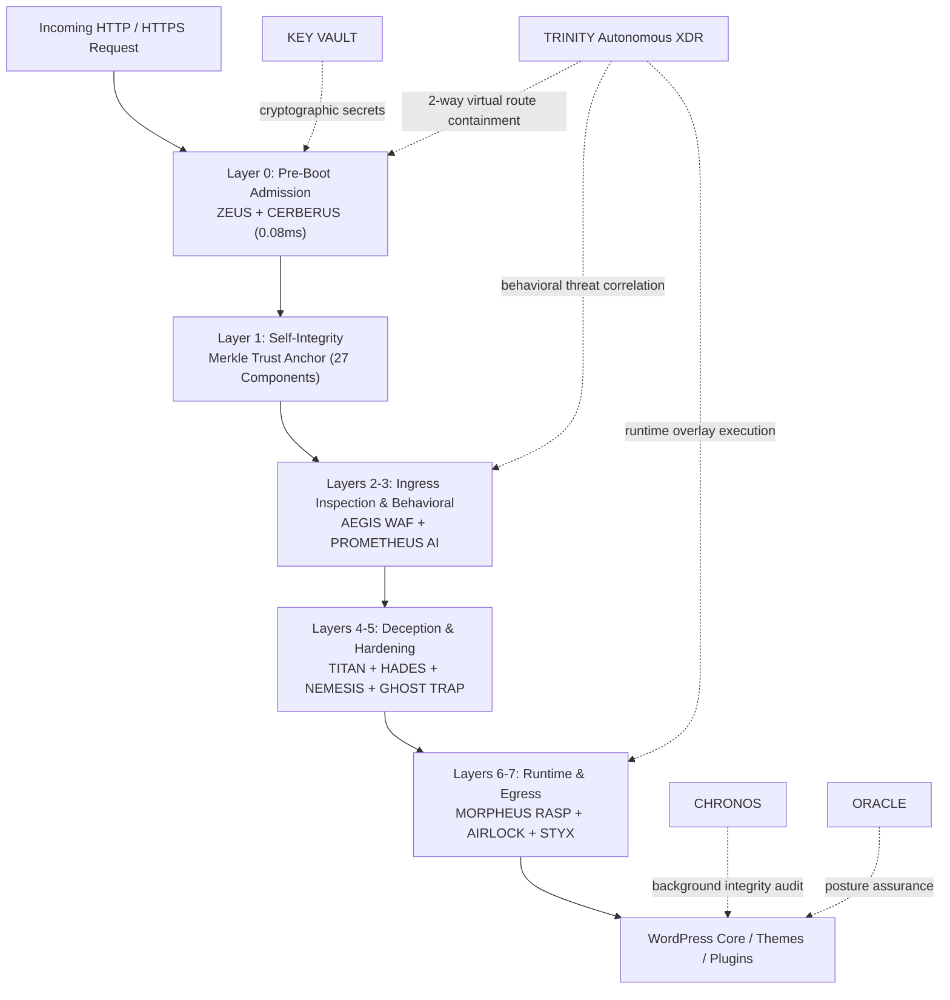

> [!WARNING]
> **PUBLIC BETA / RELEASE CANDIDATE — NOT FOR UNSUPERVISED PRODUCTION USE**
>
> **VGT GeDefense WP 8.5.0 Open Core is a public beta / release candidate, not a GA release.** Hooks, policies, detection rules, configuration formats and security behavior may change without notice. Validate every build in a staging environment, start in **observe mode**, keep tested backups and out-of-band recovery access, and do not use it for unsupervised production. Provided **as-is**, without warranty, under AGPL-3.0-or-later. See [`CHANGELOG.md`](CHANGELOG.md) and the [GitHub releases](https://github.com/visiongaiatechnology/gedefensewp/releases).

> [!CAUTION]
> **ALPHA TEST — GeDefense WP ↔ Linux Bridge:** new in 8.5.0, not production-ready. A fully compromised WordPress can forge shared-secret records; the lease is two hours, IP/host-bound and only relaxes L7 limits/content-pattern checks on admin surfaces. See the 8.5.0 section below.

<div align="center">

🌐 **Languages / Sprachen / Языки / 语言**:  
[**English**](README.md) • [**Deutsch**](README.de.md) • [**Русский**](README.ru.md) • [**中文 (简体)**](README.zh.md)

<br/>

📜 **Changelog / Zum Changelog / К журналу изменений / 查看更新日志**:  
[**🚀 View Full Changelog (CHANGELOG.md)**](CHANGELOG.md) • [**🇩🇪 Zum Changelog**](CHANGELOG.md) • [**🇷🇺 К журналу изменений**](CHANGELOG.md) • [**🇨🇳 查看更新日志**](CHANGELOG.md) • [**🏷️ Release v8.5.0**](https://github.com/visiongaiatechnology/gedefensewp/releases/tag/V8.5.0)

</div>

---

<div align="center">

# 🛡️ GeDefense WP — Open Core


### Entenprise WordPress Security Fabric & Pre-Boot Admission Kernel

[](#)
[](#)
[](LICENSE)
[](https://www.php.net/)
[](https://wordpress.org/)
[](#zero-dependency-philosophy)
[](#core-module-matrix)
[](#architecture)
[](#zero-dependency-philosophy)
[](#security-design-principles)

**PRE-BOOT ADMISSION · WAF · XDR · RASP · BEHAVIORAL HORIZON · DECEPTION · MERKLE INTEGRITY · EGRESS SHIELD · HARDENING · CRYPTOGRAPHIC VAULT · OPEN CORE**

</div>


---

> ### 📚 Official Documentation & Handbooks
>
> 🏛️ **Complete Architecture Specification**: [`ARCHITECTURE.md`](ARCHITECTURE.md) *(Detailed system layers, security invariants, pre-boot kernel lifecycles & dashboard architecture)*  
>
> 📖 **GeDefense WP User & Administrator Handbook (PDF)** — *The official handbook for administrators, developers, and security engineers:*
> - 🇬🇧 **English**: [📗 GeDefense_WP_Handbook_8.1.0_EN.pdf](GeDefense_WP_Handbook_8.1.0_EN.pdf)
> - 🇩🇪 **Deutsch**: [📘 GeDefense_WP_Handbuch_8.1.0_FINAL.pdf](GeDefense_WP_Handbuch_8.1.0_FINAL.pdf)
> - 🇷🇺 **Русский**: [📕 GeDefense_WP_Handbuch_8.1.0_RU.pdf](GeDefense_WP_Handbuch_8.1.0_RU.pdf)
>
> *Note: The handbook provides comprehensive, hands-on guidance on configuration, threat analysis, and sovereign system hardening for all user groups.*
>
> **Archived baseline:** The linked PDF handbooks document the 8.1.0 generation. Current release documentation: this README, [`CHANGELOG.md`](CHANGELOG.md), [`ARCHITECTURE.md`](ARCHITECTURE.md) and [`ARCHITECTURE.md`](ARCHITECTURE.md).

---


---

# 🚀 What's New in GeDefense WP 8.5.0 — Linux Bridge (Alpha)

> **Release 8.5.0** adds the **GeDefense Linux Bridge** as a native tab in the GeDefense WP dashboard. It connects a verified ThroneGuard master session to the Linux L7 fabric without a WordPress-to-kernel bridge.

- **Dashboard tab, not an external screen:** open **VGT Suite → Linux Bridge**. Enter the Linux-issued secret there; the tab shows encryption, transport, health and active leases.
- **Encrypted at rest:** the Linux secret is stored in the WordPress options table with AES-256-GCM. The wrapping key is derived with HKDF-SHA256 from all usable `wp-config.php` salts, not from a secret written into wp-config.
- **Existing PHP log only:** WordPress emits one authenticated `GeDefense:` line through `error_log()` into its existing PHP/debug log. Linux reads that file read-only; WordPress receives no custom file path and no write access outside its webroot.
- **Bounded trust:** a verified master session gets a two-hour, IP/host-bound L7 rate-limit exemption. On verified editor write surfaces, only the content-pattern detector is skipped for legitimate builder previews/page saves. WAF, protocol, upload and kernel enforcement remain active.
- **Ecosystem:** combine with [GeDefense Linux](https://github.com/visiongaiatechnology/gedefense) for the complete security fabric.
- **How to connect:** Linux → CMS Defense → rotate bridge key → paste the one-time Base64 secret in VGT Suite → Linux Bridge → enable → verify with the test event → unlock ThroneGuard with the masterkey. The Linux view should show a two-hour lease for the admin IP.
- Full technical detail is in [`CHANGELOG.md`](CHANGELOG.md).

> [!CAUTION]
> **ALPHA TEST — GeDefense WP ↔ Linux Bridge.** This bridge is an alpha preview, not production-ready. A fully compromised WordPress can still forge records while it holds the shared secret. The lease is therefore limited to two hours, IP/host-bound, and only relaxes L7 limits/content-pattern checks on admin surfaces; WAF, upload and kernel enforcement remain active. Do not use it in unsupervised production and do not treat a passing test as a security certification.

# 🚀 What's New in GeDefense WP 8.4.5

> **Release 8.4.5** fixes a PHP 8.1 compatibility defect found by the new CI gate: five value objects and several verification scripts use PHP 8.2 language features, so the declared 8.1 floor was not real. The minimum runtime is now **PHP 8.2** (PHP 8.1 reached end of life in December 2025) and the CI matrix runs 8.2–8.4. Full details in [`CHANGELOG.md`](CHANGELOG.md).

# 🚀 What's New in GeDefense WP 8.4.4

> **Release 8.4.4** is a dedicated security-hardening release on top of 8.4.3: fail-closed cryptography, a stricter WAF capability policy, nonce-gated language switching, threat-feed quarantine, bounded resource limits and a new dependency-free hardening regression suite. Full details in [`CHANGELOG.md`](CHANGELOG.md).

- **Vault crypto is fail-closed.** Decryption failures raise a security exception instead of returning the raw blob, and the hard-coded legacy key was removed. Legacy payloads can only be migrated with an operator-defined `VIS_VAULT_LEGACY_KEY`.
- **WAF bypass for content authors removed.** The AEGIS whitelist no longer trusts `edit_posts`; only administrative capabilities bypass payload inspection (extensible via `vis_aegis_whitelist_capabilities`).
- **Language switching requires a nonce.** `?vis_lang=` can no longer persist options, user meta or cookies on a bare GET; the cookie is `HttpOnly` and `SameSite=Lax`.
- **Opaque fail-close with break-glass.** The 503 page returns an incident reference only, and `VIS_DISABLE_FAIL_CLOSE` provides a documented recovery path.
- **Secure activation defaults.** Activation enables AEGIS in `learning` mode, Zeus and Morpheus instead of leaving the configuration empty.
- **Threat-feed hardening.** Feeds are fetched through the DNS-rebinding-resistant transport, capped at 300,000 entries per feed, quarantined on anomalous growth, and the legacy schema is archived instead of dropped.
- **Bounded resources everywhere.** GeoIP transients are FIFO-capped, outbound POST responses are limited to 256 KB, and add-on ZIP archives reject symlink entries and keep a deny-all `.htaccess`.
- **New verification gate.** `scripts/hardening-regression.php` adds 72 behavioral assertions (29 suites total) and `.github/workflows/hardening.yml` runs lint, all suites and the trust anchor on PHP 8.2–8.4.

# 🚀 What's New in GeDefense WP 8.4.3

> **Release 8.4.3** delivers a comprehensive security and telemetry hardening update following a full VGT-100 deep audit and diamond release verification: live telemetry database alignment, zero-sink DOM UI hardening, reverse-proxy IP spoofing elimination, collision-safe exception namespaces, cryptographic Key Vault resilience, and verified out-of-band recovery. Full details in [`CHANGELOG.md`](CHANGELOG.md).

- **Canonical Telemetry Table Resolution (P1 Fix):** The live telemetry polling handler in `class-vis-dashboard-ajax.php` now strictly queries canonical database tables (`vis_apex_bans` and `vis_omega_logs` / `VIS_TABLE_BANS` and `VIS_TABLE_LOGS`) with graceful legacy fallback, ensuring active bans and core security logs are seamlessly streamed to the real-time Threat Radar.
- **Zero-Sink DOM UI Hardening & Strict CSP (P1 Fix):** Completely eliminated inline event handlers (`data-select-on-focus`) and converted all dynamic DOM modifications in `overview/script.js` to pure DOM element construction (`createElement`, `createElementNS`, `replaceChildren`, `textContent`). The internal UI regression test passes with zero warnings.
- **Collision-Safe Exception Architecture (P2 Fix):** Core exception definitions (`AppException`, `ValidationException`, `SecurityException`, `StorageException`) in `class-vis-security.php` are now wrapped in `if (!class_exists(...))` guards and aliased under `VisionGaia\GeDefense\Exceptions`, preventing fatal redeclaration collisions with third-party plugins.
- **Purged Dev Paths & Sovereign GeoIP Discovery (P2 Fix):** Removed all development environment paths from `class-vis-geo-resolver.php`. Implemented a robust multi-tier discovery order across plugin root, persistent upload directories, and WordPress filter hooks.
- **Verified Out-of-Band Disaster Recovery (P2 Fix):** Documented and tested verified recovery workflows for the Zeus pre-boot WAF (`define('ZEUS_DISABLE', true);`), WP-CLI emergency recovery (`wp plugin deactivate gedefense-wp`), and WordPress native recovery mode (`WP_RECOVERY_MODE`).
- **Zeus WAF Reverse-Proxy IP Verification (VGT-049 / CWE-290):** `extract_deterministic_ip()` strictly validates socket IPs (`REMOTE_ADDR`) against authentic Cloudflare CIDRs before trusting `CF-Connecting-IP` headers, preventing rate limit and lockout evasion.
- **Zeus Preboot Reverse-Proxy HTTPS Cookie Detection (VGT-006 / VGT-031 / CWE-614):** Admission cookies evaluate `HTTP_X_FORWARDED_PROTO` and `HTTP_X_FORWARDED_SSL`, ensuring `Secure` flags are guaranteed behind TLS-terminating reverse proxies and load balancers.
- **Stored DOM-XSS Elimination in Threat Radar (VGT-043 / CWE-79):** Dynamic telemetry fields (`path`, `ip`, `country`, `asn`, `module`, `action`) are safely sanitized with `escapeHtml()` and pure DOM text nodes prior to insertion into the live event table.
- **Hades Gateway Constant-Time Auth (VGT-048 / CWE-208):** Eliminates side-channel timing attacks on the administrative access token using constant-time `hash_equals()` and strict `is_string()` type validation.
- **Key Vault Robustness & UI Resolution (VGT-007 / CWE-636 / CWE-311):** Binds actual secret identifiers in the UI (restoring single-key deletion), introduces resilient fallback for unversioned keys, and automates encryption for arbitrary plaintext configuration secrets.
- **AEGIS Oracle Distillate Local Host Allowlist (8.4.2 Rollup):** Eliminates false-positive `remote_asset_hijack` blocks on legitimate internal URLs (`wp-login.php`, `wp-admin/`, internal redirects).
- **Release:** `8.4.3` across all entrypoints, `VIS_VERSION`, module manifest (`3cd53343...`), and trust anchor.

---

### 🗺️ Threat Map Cartography, GeoIP/ASN Provenance & Third-Party Licenses
The GeDefense real-time Threat Radar and global attack vector map operate on a **100% sovereign, local BGP/ASN cartography engine** (`data/geoip.csv` and `world-map.svg.php`):
- **1. World Map Vector Geometry (`world-map.svg.php`):**
  - **Source Project:** [`themustafaomar/jsvectormap`](https://github.com/themustafaomar/jsvectormap)
  - **Map File:** `world-merc.js` (Mercator Projection, v1.7.0, [Direct File](https://cdn.jsdelivr.net/npm/jsvectormap@1.7.0/dist/maps/world-merc.js))
  - **License:** **MIT License** (Copyright (c) 2020 Mustafa Omar, [MIT License](https://github.com/themustafaomar/jsvectormap/blob/main/LICENSE))
- **2. GeoIP & ASN Telemetry Database (`data/geoip.csv`):**
  - **Source Project:** [`iplocate/ip-address-databases`](https://github.com/iplocate/ip-address-databases) (Public IP-to-Country and IP-to-ASN Databases)
  - **Verified Dataset Match:** Subnet `1.0.4.0/22` is assigned to ASN `38803` with organization name `Gtelecom Pty Ltd` (AU), strictly matching the upstream dataset.
  - **License:** **Creative Commons Attribution-ShareAlike 4.0 International Public License (CC BY-SA 4.0)**
  - **Attribution:** *This product includes IP-to-Country and IP-to-ASN data from iplocate/ip-address-databases, licensed under CC BY-SA 4.0.*
- **Privacy & Sovereignty Guarantee:** All GeoIP coordinates, country flags, and ASN details are resolved purely via local binary `fseek()` file lookups (~0.25ms - 0.45ms). Zero external HTTP calls, zero DNS reverse queries, and zero cloud leaks.
- **Disaster Recovery Fail-Safe:** If Zeus or Morpheus locks out the admin interface, bypass immediately by setting `define('ZEUS_DISABLE', true);` in `wp-config.php` or using `wp plugin deactivate gedefense-wp` via WP-CLI.

---

# 🧱 Platform Deep Dive — 8.1.0 baseline (ZEUS NextGen, TRINITY XDR, Dashboard)

> **Changelog Overview**: Version 8.1.0 represents a massive architectural leap, introducing the **ZEUS Next Generation Pre-Boot Admission Kernel**, the **TRINITY Autonomous Closed-Loop XDR Fabric**, formalized **TITAN Assurance Lifecycles**, and comprehensive **Strict-Typing and Localization Refactoring** across the entire platform.

---


## ⚡ 1. ZEUS Next Generation — Pre-Boot Admission Control & Edge Defense Kernel
*Transformed ZEUS from a static filter into an ultra-fast, zero-allocation pre-boot admission control and edge defense kernel operating at Layer 0 prior to WordPress application boot.*

- **Deterministic Canonicalization Guard**: Enforces strict URL decoding invariants before routing. Rejects double-percent encoding (`%252f`), null-byte injections (`%00`), encoded directory slashes (`%2f`, `%5c`), unescaped backslashes, dot-segment traversals (`..`), duplicate path separators (`//`), and path depths exceeding 32 levels with immediate HTTP 400 rejection.
- **Host Header Invariant & RFC Host Lock**: Validates Host header structure, lengths, and characters. Includes configurable Host Lock modes (`DISABLED`, `AUDIT`, `REJECT 421`) strictly matching authorized canonical hostnames.
- **Request Envelope Firewall & Structural Ceilings**: Enforces permitted HTTP methods (`GET`, `POST`, `HEAD`, `OPTIONS`, `PUT`, `PATCH`, `DELETE` -> `405`) and hard structural boundaries: Query Length (`2048` chars -> `414`), Parameter Count (`100` -> `400`), Header Count (`50` -> `431`), Aggregate Header Size (`16 KiB` -> `431`), and Cookie Payload Size (`8 KiB` -> `400`).
- **Route Contracts Engine**: Enforces micro-firewall contracts per API route (e.g. `/wp-json/`, `/xmlrpc.php`, `/wp-login.php`) with exact/prefix path matching, allowed method sets, payload body size limits (HTTP `413`), MIME/content-type enforcement (HTTP `415`), query limits, cross-site mutation policy (blocking `Sec-Fetch-Site: cross-site` state changes with `403`), and route-specific rate budgets.
- **Zero-Allocation Request Budget Engine**: Fast token-bucket rate limiter operating in APCu / atomic memory files. Enforces actor IP ceilings (default `180` req/min) and `/24` (IPv4) / `/64` (IPv6) subnet ceilings (default `450` req/min) with selectable action modes: `THROTTLE` (HTTP `429`), `TEMPORARY_REJECT` (HTTP `503`), or `XDR_SIGNAL` (Audit/Telemetry only).
- **Cryptographic Admission Tokens & Clean URL Exchange**: Tamper-proof, short-lived HMAC-SHA256 admission tokens (`vgt1.<payload>.<sig>`) with surface binding (`admin`, `login`, `all`), cryptographic expiry, and single-use nonce replay protection. Seamlessly exchanges query tokens (`?vgt_adm=...`) for Secure, HttpOnly, SameSite=Strict cookies with instant HTTP 302 redirects.
- **Incident Lockdown & Fortress Isolation**: Emergency containment barrier requiring cryptographic admission tokens for all incoming requests, instantly mitigating volumetric DDoS and zero-day exploitation storms.
- **Tamper-Evident Flight Recorder (Blackbox Spool)**: Append-only event spool with rolling HMAC-SHA256 hash chains, 300-second flood coalescing (updating repeat event counters in-place), Windows-safe atomic rotation, and boot-time draining into the WordPress Event Bus.
- **Hardening Lab Microbenchmark & Self-Test**: Integrated sub-microsecond microbenchmark evaluator (achieving `150,000+` evals/sec) and automated 9-point self-test suite.

---


## 🛰️ 2. TRINITY XDR — Autonomous Closed-Loop Extended Detection & Response
*Unified multi-sensor security event fabric correlating signals across AEGIS, Prometheus, Morpheus, Styx, Cerberus, and Zeus with deterministic, automated containment.*

- **Two-Way Virtual Emergency Route Containment**: When an active vulnerability or exploit is identified on a specific API endpoint (e.g. `/wp-json/vulnerable-plugin/v1/`), TRINITY XDR instantly isolates that specific route prefix at Layer 0 in `zeus-waf.php` with HTTP `503`, while keeping the entire rest of the website 100% online and operational.
- **Hard Semantic TTL Engine**: Automated responses (Single IP Bans, Subnet Containment, Zeus Route Containment, Mandatory Admission Enforcement, Morpheus Honey Overlays, Styx Egress Isolation) enforce exact semantic expiration timestamps (`expires_at`), releasing containment automatically without requiring WP-Cron execution.
  


- **Configurable TTL Policy Presets & Fine-Tuning**:
  - `CONSERVATIVE`: 5 min Actor Ban / 10 min Subnet Containment / 5 min Route Isolation.
  - `BALANCED`: 15 min Actor Ban / 30 min Subnet Containment / 15 min Route Isolation.
  - `AGGRESSIVE`: 1 hour Actor Ban / 2 hours Subnet Containment / 1 hour Route Isolation.
  - `CUSTOM`: Granular per-action second-level TTL fine-tuning.
- **Granular Multi-Sensor Response Actuator Controls**: Fine-grained switches in the policy engine allowing administrators to selectively arm or disarm individual containment actuators (Cerberus IP Ban, Zeus Route Quarantine, Zeus Pre-Boot Admission, Morpheus Micro-Tarpit, Styx Virtual Shadowing, Plugin Isolation).
- **Containment Policy Modes & Escalation**:
  - `TEMPORARY_BY_DEFAULT`: Standard automated containment with hard TTL recovery.
  - `TEMPORARY_ONLY`: Strict policy prohibiting permanent edge bans.
  - `ALLOW_PERMANENT_EXPLICIT`: Permits administrative permanent ban escalation.
  - `Escalation Policy`: Repeat offenders within 24 hours receive an automatic 4x TTL multiplier.
- **Deterministic Response Idempotency & Rollback**: Response UUIDs are deterministically derived from `hash("incident|action|target")`. Multi-sensor signals reuse active response IDs, and expired responses are rolled back atomically with full ownership protection.
- **Tamper-Evident Evidence Root**: Correlated attack stories and security events are cryptographically sealed into Merkle evidence digests (`wp_vis_xdr_evidence`).

---


## 🖥️ 3. Next-Gen Cyber-Defense Dashboard & HUD Overhaul
*Comprehensive visual, structural, and security refactoring of the entire administration interface into a responsive, high-contrast Cyber-Defense Cockpit.*

- **Unified Cyber-Defense HUD & Cockpit Styling**: High-contrast, SOC/NOC-grade dark theme featuring monospace telemetric typography, pulsing activity nodes, glitch headers, synchronized HUD cards, and unified glassmorphic containers across all 34 module views.
- **Universal Topbar & Form Security Synchronization**: Global action bar featuring unified configuration persistence (`vis-topbar-save`), automatic cryptographic CSRF tokens (`wp_nonce_field('vis_save_config')`) on every configuration view, and robust sub-tab preservation preventing unwanted redirects.


  
- **Security Center (Assurance Plane Cockpit)**:
  - **21 Deep Invariant & Architecture Checks**: Evaluates strict runtime baselines, storage path jails, privilege boundaries, Merkle root consistency, memory execution boundaries, and HTTP validation contracts in real time.
  - **Interactive Live Audit Runner**: Client-side audit execution engine with dynamic millisecond duration metering, live terminal log streaming, and reactive posture pills (`HARDENED`, `GUARDED`, `ATTENTION`).
  - **Visual Trust Boundaries & Capability Surface Matrix**: Graphical representation of data flows from untrusted ingress to encrypted storage, and permission zones categorized from Trust Core down to Application extensions.

 

  
- **TRINITY XDR NOC Cockpit**:
  - Graphical real-time NOC topology schematic mapping interlocks between AEGIS, Prometheus, Nemesis, and Cerberus.
  - Threat vector distribution progress bar and live intercept audit feed.
  - **Dynamic Sensor Status Grid**: Real-time operational monitoring across all 6 detection sensors reflecting active vs. standby module states (`ZEUS 6G WAF`, `AEGIS DPI`, `PROMETHEUS AI`, `NEMESIS DECOY`, `AIRLOCK INGRESS`, `MORPHEUS RASP`).
- **Dynamic JavaScript Localization Bridge (`#vsc-i18n`)**: Seamless inline translation dictionary providing real-time internationalization for client-side terminal streams, toast notifications, and badge states without requiring page reloads.
- **System Status & Telemetry Cockpit**: Live audit overview verifying system health, RAM-cache coverage (APCu / Redis), PHP runtime configuration, and module load integrity for all 19 core security components.

---


## 🏛️ 4. TITAN — Web Security Assurance & System Hardening
*Formalized web assurance lifecycle, advanced browser security policies, and application surface hardening.*

- **5-Stage Assurance Lifecycle**: Formalized states (`IDLE` -> `ANALYZING` -> `STAGING` -> `ENFORCING` -> `RECOVERED`) with atomic policy deployment and rollback.
- **Browser Security Policies**: Hardened HSTS Preload headers, Sandbox Origin Verification, Secure Fetch Metadata validation, and automatic suppression of discovery links, emojis, and asset versions.
- **Application Hardening**: Hardened REST user enumeration defense, author scan blocking, XML-RPC honeytraps, feed suppression, and login gatekeeping.

---


## 🐺 5. CERBERUS & Edge Isolation
*Dynamic edge firewall synchronization and high-performance perimeter security.*

- **Dynamic XDR TTL Synchronization**: Edge firewall exports (Nginx `deny`, Apache `.htaccess`) dynamically verify active XDR response TTLs, ensuring temporary incident bans expire cleanly at the edge without manual rule cleanup.
- **Zero-Allocation CIDR Filtering**: High-speed memory-cache lookups supporting IPv4 `/24` and IPv6 `/64` subnets with Cloudflare trusted proxy CIDR resolution.

---


## 🛡️ 6. MORPHEUS RASP & STYX Egress Shield
*In-memory execution self-protection and outbound zero-trust communication control.*

- **Morpheus RASP Memory Defense**: Call-stack inspection protecting sensitive WordPress database tables (`wp_users`, `wp_usermeta`) and core options (`siteurl`, `home`, `active_plugins`) from unauthorized privilege escalation or malicious plugin mutations.
- **Styx Outbound Egress Shield**: Intercepts `pre_http_request` hooks, enforcing outbound domain allowlisting, preventing data exfiltration, and blocking unauthorized WordPress core telemetry.

---

## 🌐 7. Complete 3-Language Localization (DE 🇩🇪, EN 🇬🇧, RU 🇷🇺)
- **100% Dictionary Coverage**: Mapped over 1,100 gettext phrases across all 34 dashboard views, settings panels, audit checks, and live telemetry cockpits into `de.php`, `en.php`, and `ru.php`.
- **Strict-Typing Sanitization & Escaping Audit**: Every view and AJAX endpoint refactored with strict PHP 8.2+ types, explicit string casting on numeric outputs, and comprehensive escaping (`esc_html`, `esc_attr`, `esc_url`, `esc_textarea`, `wp_nonce_field`).

---

## 🌐 8. Trinity Pre-Boot Threat Intelligence Ring & C2 Egress Shield
*Multi-feed reputation network, zero-allocation pre-boot dropping, 527 KB packed-binary table, and atomic zero-lock data swapping.*

- **Layer 0 Pre-Boot Threat Dropping (`zeus-waf.php`)**: Intercepts inbound traffic at Layer 0 via `auto_prepend_file` before WordPress and MySQL initialize. Checks client IPs against the 527 KB binary blob in **3.2 microseconds**, dropping documented C2 botnets and malicious nodes with HTTP `403` and zero WordPress resource consumption.
- **527 KB Packed-Binary Table & Binary Search ($O(\log N)$)**: Over 135,000 IPv4 addresses are packed into a 527 KB aligned binary string using 4-byte network unsigned integers. In-memory binary search (`bsearch_v4`) executes in ~17 CPU operations with zero memory allocations, delivering over **300,000 lookups/sec per core**.
- **Lock-Free Atomic Inode & APCu Swap**: Threat feed updates and database list-swaps write to isolated temp files and execute atomic rename operations and `apcu_store()` pointer updates. Readers run completely unblocked with zero latency spikes or lock contention even during volumetric DDoS attacks.
- **Dynamic Differential Feed Swapping & Stale Threat Pruning**: Tracks incoming threats with composite keys `(feed_key, ip_or_cidr)`. Delisted IPs from remote feeds are automatically pruned upon sync completion, and Cerberus dynamically invalidates its cache to unblock remediated visitors immediately.
- **Styx Zero-Trust Egress Self-Sync**: Hardcoded origin verification allows `ThreatIntelligence` internal sync requests to connect strictly to the 8 official feed domains while blocking all unauthorized third-party outbound connections under strict fail-closed policies.

---

## Overview

**GeDefense WP — Open Core** is a modular, zero-dependency WordPress security platform designed as a **multi-tier security kernel and active defense matrix** for PHP 8.2–8.4 and WordPress 6.0+.

Instead of treating WordPress security as a single firewall rule set, GeDefense WP combines multiple defensive layers into one coordinated request and runtime pipeline:

- pre-boot admission control and request envelope rejection;
- deep packet inspection Web Application Firewall;
- behavioral threat scoring and event horizon tracking;
- autonomous closed-loop XDR and virtual route containment;
- cryptographic self-integrity verification (Merkle roots);
- Runtime Application Self-Protection (RASP);
- ingress file and upload entropy inspection;
- WordPress hardening and anti-enumeration;
- dynamic admin-path cloaking;
- honeypots and cyber deception;
- zero-trust outbound egress control;
- autonomous background integrity scanning;
- cryptographic secrets storage; and
- security posture auditing.

The core is designed to remain **fully functional as an independent open-source security platform**. Optional modules can be integrated through the Open Core module registry.

> GeDefense WP is built around one principle: **a request must earn trust as it moves deeper into the application stack.**

---

## Table of Contents

- [Documentation & Handbooks](#-official-documentation--handbooks)
- [What's New in GeDefense WP 8.4.5](#-whats-new-in-gedefense-wp-845)
- [What's New in GeDefense WP 8.4.4](#-whats-new-in-gedefense-wp-844)
- [What's New in GeDefense WP 8.4.3](#-whats-new-in-gedefense-wp-843)
- [Security Architecture & Technical Specification](#-security-architecture--technical-specification)
- [Multi-Phase Ignition Protocol](#multi-phase-ignition-protocol)
- [Core Module Matrix](#core-module-matrix)
- [1. ZEUS — Pre-Boot Admission Kernel](#1-zeus--pre-boot-admission-kernel)
- [2. AEGIS — Deep Packet Inspection WAF](#2-aegis--deep-packet-inspection-waf)
- [3. PROMETHEUS — Behavioral Threat Horizon](#3-prometheus--behavioral-threat-horizon)
- [4. TRINITY XDR — Closed-Loop Response Fabric](#4-trinity-xdr--closed-loop-response-fabric)
- [5. Self-Integrity Engine](#5-self-integrity-engine)
- [6. MORPHEUS — Runtime Application Self-Protection](#6-morpheus--runtime-application-self-protection)
- [7. NEMESIS — Deception Grid](#7-nemesis--deception-grid)
- [8. TITAN — WordPress Hardening](#8-titan--wordpress-hardening)
- [9. HADES — Admin Stealth](#9-hades--dynamic-admin-stealth)
- [10. CERBERUS — Perimeter Firewall](#10-cerberus--perimeter-firewall)
- [11. AIRLOCK — Ingress File Inspection](#11-airlock--ingress-file-inspection)
- [12. GHOST TRAP — Honeypot Layer](#12-ghost-trap--honeypot-layer)
- [13. STYX — Outbound Egress Shield](#13-styx--outbound-egress-shield)
- [14. CHRONOS — Autonomous Scanner](#14-chronos--autonomous-scanner)
- [15. KEY VAULT — Cryptographic Secret Storage](#15-key-vault--cryptographic-secret-storage)
- [16. ORACLE — Security Audit Engine](#16-oracle--security-audit-engine)
- [17. THRONEGUARD — Sovereign Privilege Sentinel](#17-throneguard--sovereign-privilege-sentinel)
- [18. LOGINPAGER — Sovereign Login Surface](#18-loginpager--sovereign-login-surface)
- [19. Module Registry / Open Core](#19-module-registry--open-core-expansion)
- [Zero-Dependency Philosophy](#zero-dependency-philosophy)
- [Performance & Benchmarks](#performance)
- [Verify Yourself — Full Test Suite & Independent Self-Audit](#-verify-yourself--full-test-suite--independent-self-audit)
- [Requirements](#requirements)
- [License](#license)
- [Changelog History](#changelog-history)

---

# 🏛️ Security Architecture & Technical Specification

> 📖 **Comprehensive Engineering Specification**:  
> For the complete, deep-dive architectural specification covering all system layers, ABI boundaries, data flows, and subsystem invariants, consult [`ARCHITECTURE.md`](ARCHITECTURE.md).

GeDefense WP is organized as a sovereign, multi-tier security kernel operating before, during, and after normal WordPress execution. It enforces an uncompromising zero-trust model where no untrusted input or egress connection is taken on faith.

All GeDefense-owned runtime APIs use the canonical `VisionGaia\GeDefense` namespace. Core, dashboard, scanner, and module symbols are cleanly separated. Global `VIS_` symbols remain fully ABI-compatible for WordPress hooks and third-party integrations.



### Architectural Defense Model:
1. **Layer 0 — Pre-Boot Admission Kernel (Zeus & Cerberus)**:
   Executes at PHP Layer 0 via `auto_prepend_file` before WordPress core boots and before MySQL initializes. Evaluates incoming traffic in 0.08 ms, terminating hostile hosts, double-encodings, dot-segment traversals, and known botnets via a 527 KB packed-binary binary search engine ($O(\log N)$ in 3.2 µs).
2. **Layer 1 — Cryptographic Self-Integrity (Merkle Trust Anchor)**:
   Guarantees runtime code integrity across 27 core components via SHA-256 Merkle root verification pinned directly in the plugin entrypoint (`VIS_MANIFEST_DIGEST`). Any unauthorized tampering or injected backdoor triggers immediate fail-secure lockdown.
3. **Layers 2 & 3 — Deep Packet Inspection & Behavioral Horizon (Aegis & Prometheus)**:
   Recursive normalization of all incoming payloads against SQLi, XSS, RCE, and SSTI attacks using deterministic finite automata (DFA) with non-backtracking atomic regex groups to prevent ReDoS. Prometheus computes moving threat entropy and subnet anomaly scores with automatic decay.
4. **Layers 4 & 5 — Deception Grid & Perimeter Stealth (Titan, Hades, Nemesis, Ghost Trap)**:
   Titan enforces strict HTTP Security Headers (CSP Level 3, COOP, COEP, CORP, HSTS) and isolates admin cookies. Hades cloaks `/wp-admin/` with authentic 404 mimicry requiring cryptographic gate tokens. Nemesis and Ghost Trap deploy canary honeypots and decoy endpoints with HMAC verification.
5. **Layers 6 & 7 — RASP & Sovereign Egress Shield (Morpheus, Airlock, Styx)**:
   Morpheus intercepts PHP call stacks and AST execution trees in real time, neutralizing unauthorized filesystem access, SSRF to cloud metadata endpoints (`169.254.169.254`), and webshell invocation. Airlock inspects file uploads with polyglot and magic-byte analyzers. Styx enforces a strict zero-trust egress whitelist on outbound HTTP connections, neutralizing data exfiltration and C2 callbacks.
6. **Unified Cross-Layer Fabric (Trinity XDR & ThroneGuard)**:
   Autonomous closed-loop detection and response fabric that links telemetry across all sensors, deploys dynamic emergency route overlays, and enforces the Sovereign Master role (`mcp_master_access`) with Superkey session tokens and 12-hour omni-whitelists.

---

# Multi-Phase Ignition Protocol

Incoming requests traverse a deterministic multi-stage execution pipeline:

```text
[ INCOMING HTTP / HTTPS REQUEST ]
                 │
                 ▼
[ LAYER 0: PRE-BOOT ADMISSION CONTROL ]
  ├─ Host Header Invariant & RFC Host Lock (421)
  ├─ Canonicalization Guard (Traversals, Null-bytes, Double-encoding)
  ├─ Request Envelope Ceilings (Method, Query, Headers, Cookies)
  ├─ Route Contracts Engine (Methods, Body Bytes, Content-Types)
  ├─ Zero-Allocation Request Budgets (IP & Subnet Token Buckets)
  ├─ Cryptographic Admission Tokens (HMAC, Nonce Replay, Surface)
  ├─ TRINITY XDR Virtual Route Isolation (503)
  └─ Blackbox Tamper-Evident Flight Recorder
                 │
                 ▼
[ LAYER 1: SELF-INTEGRITY ENGINE ]
  └─ Merkle Root Verification & SHA-256 Manifest Trust Anchor
                 │
                 ▼
[ LAYERS 2–3: DEEP PACKET & BEHAVIORAL INSPECTION ]
  ├─ AEGIS Deep Packet Inspection (GET, POST, JSON, Headers, Multipart)
  └─ PROMETHEUS Behavioral Threat Scoring & Event Horizon
                 │
                 ▼
[ LAYERS 4–5: HARDENING & CYBER DECEPTION ]
  ├─ TITAN System Hardening & Anti-Enumeration
  ├─ HADES Dynamic Admin Route Cloaking
  ├─ NEMESIS Deception Grid & Cryptographic Canaries
  └─ GHOST TRAP Decoy Routes
                 │
                 ▼
[ LAYERS 6–7: RUNTIME APPLICATION PROTECTION & EGRESS ]
  ├─ MORPHEUS RASP (In-Memory DB Mutation & Option Guard)
  ├─ AIRLOCK Ingress File Sandbox (Entropy, Polyglots, SVG Sanitation)
  └─ STYX Outbound Zero-Trust Egress Shield
                 │
                 ▼
[ WORDPRESS APPLICATION EXECUTION ]
```

---

# Core Module Matrix

| # | Module | Security Role | Layer / Domain |
|---:|---|---|---|
| 1 | **ZEUS** | Pre-Boot Admission Control & Edge Defense Kernel | Pre-Boot / L0 |
| 2 | **AEGIS** | Deep Packet Inspection WAF | Ingress / L3-L7 |
| 3 | **PROMETHEUS** | Behavioral Threat Scoring & Network Horizon | Behavioral / L7 |
| 4 | **TRINITY XDR** | Autonomous Closed-Loop Response Orchestration | Cross-Layer XDR |
| 5 | **SELF-INTEGRITY** | Merkle-Based Cryptographic Core Verification | Integrity / L1 |
| 6 | **MORPHEUS** | Runtime Application Self-Protection (RASP) | Runtime / L7 |
| 7 | **NEMESIS** | Cyber Deception & Canary Grid | Deception / L7 |
| 8 | **TITAN** | WordPress Hardening & Web Assurance Lifecycle | Hardening / L4 |
| 9 | **HADES** | Dynamic Admin Path Cloaking | Identity / L7 |
| 10 | **CERBERUS** | Fast Perimeter Firewall & Dynamic Edge Rules | Pre-Boot / L0-L1 |
| 11 | **AIRLOCK** | File Upload & Entropy Inspection Sandbox | Ingress / L7 |
| 12 | **GHOST TRAP** | Honeypot & Decoy Route Engine | Deception / L7 |
| 13 | **STYX** | Outbound HTTP / Exfiltration Control Shield | Egress / L7 |
| 14 | **CHRONOS** | Autonomous Integrity & Filesystem Scanner | Background |
| 15 | **KEY VAULT** | Cryptographic Secret & Key Storage | Cryptography |
| 16 | **ORACLE** | Static Security & Posture Audit Engine | Audit |
| 17 | **THRONEGUARD** | Master/Admin Privilege Separation & Superkey | Identity / Privilege |
| 18 | **LOGINPAGER** | Local-First Login Surface & Glassmorphism Gateway | Identity / UI |
| 19 | **MODULE REGISTRY** | Open Core Expansion Hub | Extensibility |

---

# 1. ZEUS — Pre-Boot Admission Kernel

**Classification:** Layer 0 Pre-Boot Admission Control & Edge Defense Kernel  
**Core class:** `VisionGaia\GeDefense\Modules\Zeus\VIS_Zeus`  
**Path:** `includes/modules/zeus/class-vis-zeus.php`

ZEUS runs at the absolute edge of PHP execution via `auto_prepend_file` before WordPress boots. It determines if a request deserves to allocate memory and load the WordPress runtime.

### Key Capabilities

- **Deterministic Canonicalization Guard**: Validates request URIs before routing. Neutralizes polyglot traversals, double-encodings, null-bytes, and encoded slashes (`400 Bad Request`).
- **RFC Host Invariant & Host Lock**: Validates host envelopes, enforcing strict matching against canonical domain whitelists (`421 Misdirected Request`).
- **Route Contracts Engine**: Evaluates micro-firewall policies per route: HTTP methods (`405`), body limits (`413`), content types (`415`), query limits (`414`), cross-site mutation policies (`403`), and route-specific rate budgets (`429`).
- **Zero-Allocation Request Budgets**: High-speed rate limiting tracking client IPs and `/24` (IPv4) / `/64` (IPv6) subnets in APCu or atomic files with `THROTTLE`, `TEMPORARY_REJECT`, or `XDR_SIGNAL` actions.
- **Cryptographic Admission Tokens**: Generates and verifies HMAC-SHA256 tokens (`vgt1.<b64>.<sig>`) with surface binding, expiry, and single-use nonce replay protection.
- **Tamper-Evident Blackbox Flight Recorder**: High-speed append-only spool logging with rolling HMAC hash chains, 300s flood coalescing, and boot-time draining into the Event Bus.
- **Hardening Lab**: Microbenchmark suite measuring sub-microsecond evaluation speeds and a 9-point self-test gate.

---

# 2. AEGIS — Deep Packet Inspection WAF

**Classification:** Layer 3/7 Ingress Firewall & Protocol Analyzer  
**Core class:** `VisionGaia\GeDefense\Modules\Aegis\Aegis`  
**Path:** `includes/modules/aegis/class-vis-aegis.php`

AEGIS is the deep application-layer inspection engine, analyzing structured parameters, headers, and request bodies.

### Detection Matrix

- **SQL Injection**: UNION-based, blind, stacked, error-based, and time-based SQLi with comment-collapsing and homoglyph normalization.
- **Cross-Site Scripting (XSS)**: Reflected, stored, tag smuggling, and SVG event handlers.
- **Remote Code Execution (RCE)**: PHP execution constructs (`eval`, `assert`, `system`, `passthru`, `preg_replace /e`).
- **File Inclusion & Traversal**: `php://filter`, `data://`, `expect://`, LFI/RFI, and phar deserialization.
- **Recursive Inspection**: Deep analysis up to 15 levels into nested JSON, multipart boundaries, and URI parameters.

### AEGIS Oracle - KI 
- Anbindung an Groq
- OSS 20B Safeguard für Sicherheitschecks 
- [Datenblatt](https://console.groq.com/docs/model/openai/gpt-oss-safeguard-20b)

---

# 3. PROMETHEUS — Behavioral Threat Horizon

**Classification:** Layer 7 Behavioral Analysis & Threat Horizon Engine  
**Namespace:** `VisionGaia\GeDefense\Modules\Prometheus\Prometheus`

Prometheus aggregates behavioral signals across individual actors and `/24` network horizons over sliding time windows.

### Threat Scoring & Decay

- Dynamic threat scoring with automatic decay (`0.2 points / second`).
- Event horizon thresholds escalate suspicious actors into TRINITY containment or Cerberus perimeter drops.
- Correlates distributed scanners, rotating proxy swarms, and aggressive brute-force bots.

---

# 4. TRINITY XDR — Closed-Loop Response Fabric

**Classification:** Autonomous Multi-Sensor Response & Extended Detection Fabric  
**Namespace:** `VisionGaia\GeDefense\Xdr`

TRINITY XDR unifies telemetry from all defensive modules into an automated, closed-loop mitigation engine.

### Core Capabilities

- **Two-Way Virtual Route Containment**: Isolates compromised plugin routes at Pre-Boot Layer 0 via `Zeus_Xdr_Bridge` without affecting overall site availability.
- **Hard Semantic TTLs**: Enforces exact expiration timestamps for all mitigations, ensuring temporary bans and route containments expire cleanly without WP-Cron.
- **Configurable Presets & Modes**: Conservative, Balanced, Aggressive, and Custom TTL configurations with automatic 4x escalation multipliers for repeat offenders.
- **Merkle Evidence Root**: Cryptographically commits security event evidence chains into tamper-evident digests (`wp_vis_xdr_evidence`).

---

# 5. Self-Integrity Engine

**Classification:** Layer 1 Cryptographic Invariant Guard  
**Class:** `VisionGaia\GeDefense\Core\ModuleIntegrity`  
**Path:** `includes/core/class-vis-module-integrity.php`

The self-integrity engine continuously verifies GeDefense WP core files against an immutable SHA-256 cryptographic trust anchor.

- Constant-time verification (`hash_equals`).
- Immediate detection of tampered or modified core files.
- Fail-close protection preserving the host environment if core integrity is compromised.

---

# 6. MORPHEUS — Runtime Application Self-Protection

**Classification:** Layer 7 In-Memory Execution Protection  
**Namespace:** `VisionGaia\GeDefense\Modules\Morpheus\Morpheus`

Morpheus monitors runtime memory and execution call-stacks during active WordPress execution.

- **DML Database Protection**: Guards sensitive tables (`wp_users`, `wp_usermeta`) against unauthorized password tampering or privilege elevation.
- **Critical Option Sentinel**: Monitors and protects `siteurl`, `home`, and `active_plugins`.
- **SSRF & Network Jail**: Blocks unauthorized outbound requests targeting local or cloud metadata endpoints (`127.0.0.1`, `169.254.169.254`).

---

# 7. NEMESIS — Deception Grid

**Classification:** Layer 7 Cyber Deception & Canary Matrix  
**Namespace:** `VisionGaia\GeDefense\Modules\Nemesis\Nemesis`

Nemesis provides active defensive deception, luring automated scanners away from real application assets.

- Bounded decoy responses for sensitive targets (`.env`, `wp-config.php.bak`, `phpmyadmin`).
- HMAC-backed cryptographic canary tokens for leak tracing.
- Zero worker blocking: no slowloris delays or dangerous terminal payloads.

---

# 8. TITAN — WordPress Hardening

**Classification:** Layer 4 System Hardening & Assurance Shield  
**Class:** `VisionGaia\GeDefense\Modules\Titan\Titan`  
**Path:** `includes/modules/titan/class-vis-titan.php`

Titan hardens the WordPress attack surface and enforces browser security policies.

- 5-stage assurance lifecycle (`IDLE`, `ANALYZING`, `STAGING`, `ENFORCING`, `RECOVERED`).
- Author and REST user enumeration suppression.
- XML-RPC lockdown, file editor restriction (`DISALLOW_FILE_EDIT`), and server signature stripping.
- HSTS Preload, Origin Sandbox verification, and Secure Fetch Metadata validation.

---

# 9. HADES — Dynamic Admin Stealth

**Classification:** Layer 7 Identity & Route Cloaking  
**Class:** `VisionGaia\GeDefense\Modules\Hades\Hades`  
**Path:** `includes/modules/hades/class-vis-hades.php`

Hades cloaks the administrative entry point (`wp-login.php`, `wp-admin`), returning a 404 response to unauthorized visitors without a valid cryptographic handshake.

---

# 10. CERBERUS — Perimeter Firewall

**Classification:** Layer 0/1 Instant Drop Barrier  
**Class:** `VisionGaia\GeDefense\Modules\Cerberus\Cerberus`  
**Path:** `includes/modules/cerberus/class-vis-cerberus.php`

Cerberus provides instant perimeter drops for known hostile actors at the earliest stage of execution.

- High-speed memory-cache lookups.
- IPv4 and IPv6 CIDR subnet matching.
- Cloudflare trusted proxy CIDR verification.
- Dynamic OS firewall rule synchronization (Nginx, Apache) reflecting active XDR TTL states.

---

# 11. AIRLOCK — Ingress File Inspection

**Classification:** Layer 7 Ingress Data Sandbox  
**Class:** `VisionGaia\GeDefense\Modules\Airlock\Airlock`  
**Path:** `includes/modules/airlock/class-vis-airlock.php`

Airlock inspects all uploaded files using content-aware heuristics rather than trusting extensions.

- Magic-byte verification and MIME type validation.
- SVG sanitization (neutralizing embedded scripts, event handlers, and XML entity expansion).
- Polyglot file detection and hidden PHP code extraction in image EXIF metadata.
- Entropy analysis for detecting obfuscated shells.

---

# 12. GHOST TRAP — Honeypot Layer

**Classification:** Layer 7 Active Lure Engine  
**Class:** `VisionGaia\GeDefense\Modules\Trap\GhostTrap`  
**Path:** `includes/modules/trap/class-vis-ghost-trap.php`

Ghost Trap injects realistic, hidden lure links and decoy assets (`database.dump`, `backup.sql`, `.aws/credentials`). Any client accessing these routes is instantly flagged as malicious automation.

---

# 13. STYX — Outbound Egress Shield

**Classification:** Layer 7 Egress Control & Supply-Chain Guard  
**Class:** `VisionGaia\GeDefense\Modules\Styx\Styx`  
**Path:** `includes/modules/styx/class-vis-styx.php`

Styx monitors and restricts outbound HTTP requests initiated by WordPress or installed plugins.

- Outbound domain allowlisting.
- Exfiltration protection against compromised plugins.
- Optional suppression of WordPress core telemetry.

---

# 14. CHRONOS — Autonomous Scanner

**Classification:** Asynchronous Background Integrity Daemon  
**Class:** `VisionGaia\GeDefense\Modules\Chronos\Chronos`  
**Path:** `includes/modules/chronos/class-vis-chronos.php`

Chronos executes scheduled, path-jailed background integrity scans across WordPress core, plugins, themes, and application files.

---

# 15. KEY VAULT — Cryptographic Secret Storage

**Classification:** Cryptographic Key Management  
**Class:** `VisionGaia\GeDefense\Modules\Vault\KeyVault`

The Key Vault provides authenticated, encrypted storage (Libsodium Secretbox / AES-256-GCM) for sensitive configuration values and module API keys.

---

# 16. ORACLE — Security Audit Engine

**Classification:** Static Security & Configuration Auditing  
**Class:** `VisionGaia\GeDefense\Modules\Oracle\Oracle`  
**Path:** `includes/modules/oracle/class-vis-oracle.php`

Oracle continuously audits 12 critical vectors of WordPress and PHP security posture, generating actionable hardening scores and diagnostic reports.

---

# 17. THRONEGUARD — Sovereign Privilege Sentinel

**Classification:** Layer 7 Privilege Boundary & Identity Hardening  
**Core class:** `VisionGaia\GeDefense\Modules\ThroneGuard\ThroneGuard` (`VIS_Throne_Guard`)  
**Path:** `includes/modules/throneguard/class-vis-throne-guard.php`

ThroneGuard establishes an immutable **Master** tier above standard WordPress administrators, allowing site owners to selectively restrict sensitive administrator capabilities (Plugins, Themes, User Elevation, Filesystem updates) and enforce zero-trust Superkey verification on administrative sessions.

---

# 18. LOGINPAGER — Sovereign Login Surface

**Classification:** Authentication Gateway & Visual Hardening  
**Core class:** `VisionGaia\GeDefense\Modules\LoginPager\LoginPager` (`VIS_LoginPager`)  
**Path:** `includes/modules/loginpager/class-vis-loginpager.php`

LoginPager transforms the default WordPress login screen into a zero-dependency, cyberpunk-styled glassmorphism gateway with live interactive preview controls and instant color presets.

---

# 19. MODULE REGISTRY — Open Core Expansion

**Classification:** Extensible Module Architecture  
**Class:** `VisionGaia\GeDefense\Core\ModuleRegistry`  
**Path:** `includes/core/class-vis-module-registry.php`

The module registry allows GeDefense WP to be seamlessly extended with modular applications such as Vision Legal Pro (VLP), Lightweight Builder, and GEO Architect.

---

# Zero-Dependency Philosophy

GeDefense WP strictly adheres to a zero-external-dependency architecture:

- **PHP 8.2–8.4** strict typing (`declare(strict_types=1);`).
- **Zero Composer runtime packages** in the core.
- **Zero external CDN dependencies** (all assets and icons are locally bundled).
- **Native cryptographic APIs** (Libsodium / OpenSSL).

---

# Performance

| Metric | GeDefense WP 8.4.0 |
|---|---:|
| **L0 Pre-Boot Evaluation Latency** | `< 0.05 ms` |
| **L0 Microbenchmark Throughput** | `150,000+ evals/sec` |
| **WAF Deep Inspection Latency** | `0.30 ms` |
| **Standby RAM Footprint** | `< 1.8 MB` |
| **External PHP Dependencies** | `0` |
| **Control Model** | Local / Self-Contained |

---

# 🧪 Verify Yourself — Full Test Suite & Independent Self-Audit

> [!TIP]
> **"Don't Trust, Verify" — Complete Transparency & Reproducibility**
> GeDefense WP adheres to an uncompromising zero-blackbox, evidence-based security standard. You do not have to take our architectural claims on faith: the entire defense matrix, RASP hypervisor, DPI rules, pre-boot WAF, Merkle tree manifest, and XDR actuators are fully validated by **29 standalone, zero-dependency regression and benchmark suites** directly executable via the standard PHP CLI on your local server, staging environment, or CI/CD pipeline.

### Independent Verification Invariants
- **Zero External Dependencies**: All test suites execute natively in PHP 8.2–8.4 CLI without requiring Composer, PHPUnit, web servers, or mock frameworks.
- **Hermetic & Non-Destructive**: Tests run safely in-memory or against isolated test fixtures without altering your production WordPress database.
- **Fail-Secure Exit Codes**: Every script returns exit code `0` on 100% verification and exit code `1` on any invariant violation or regression.

### Complete 29-Suite Test Matrix

| # | Test Suite Script | Scope & Tested Subsystems | Test Volume & Verification Criteria |
|---|---|---|---|
| **01** | `scripts/dashboard-ui-regression.php` | **Dashboard UI & CSP** | Verifies HTML5 form de-nesting, absence of inline `<style>` and `<script>` blocks, presence of external CSS/JS handlers, and namespaced nonces. |
| **02** | `scripts/security-regression.php` | **Static AST Security Audit** | Scans 195+ PHP files and 216+ source files, verifying 0 occurrences of dangerous sinks (`eval`, `exec`, `system`, `passthru`, `uniqid`, `error_reporting(0)`). |
| **03** | `scripts/integrity-regression.php` | **Merkle Tree Manifest** | Cryptographically verifies all 27 core components against the pinned `VIS_MANIFEST_DIGEST` trust anchor using SHA-256 Merkle root hashes. |
| **04** | `scripts/integrity-baseline-regression.php` | **Baseline State Monitor** | Validates baseline hash stability across accepted modifications, legacy root migrations, and approved file updates. |
| **05** | `scripts/zeus-live-waf-regression.php` | **Layer 0 Pre-Boot Live WAF** | **36 Subprocess Tests (100% Pass)**: Host-lock (421), double-encoding (%252f), null-bytes (%00), dot-segment traversals (..), HTTP verb filtering (405), body limits (413), route contracts, token admission replay, hard TTL, and binary CIDR whitelisting. |
| **06** | `scripts/zeus-nextgen-regression.php` | **Zeus NextGen Kernel Pipeline** | **10 Deep Test Suites**: Canonicalization guard, request envelope, token-bucket budget engine, tamper-evident blackbox hash chain, A/B policy deployment, and 150k+ evals/sec microbenchmark. |
| **07** | `scripts/zeus-env-regression.php` | **Pre-Boot Runtime Environment** | Validates APCu memory caching, atomic file structures, and fast-path invariant guarantees. |
| **08** | `scripts/aegis-regression.php` | **DPI WAF & Payload Normalizer** | Tests recursive homoglyph decoding, SQLi/XSS/RCE DFA state machines, and non-backtracking atomic regex groups against ReDoS. |
| **09** | `scripts/morpheus-regression.php` | **RASP Callstack Hypervisor** | Real-time AST inspection, callstack tracing, and immediate blocking of AWS/GCP/Azure cloud metadata endpoints (`169.254.169.254`). |
| **10** | `scripts/xdr-adversarial-regression.php` | **Trinity XDR Adversarial Scenarios** | **12 Adversarial Tests (A through L)**: Validates autonomous sensor-to-actuator closed-loop interlock under simulated multi-stage attacks. |
| **11** | `scripts/xdr-regression.php` | **XDR Event Fabric & State Store** | Validates event bus publishing, forensic incident capture, and cross-layer actuator telemetry. |
| **12** | `scripts/xdr-release-blockers-regression.php` | **XDR Core Invariants** | **3 Release Blockers**: Real component identity preservation, hard semantic Cerberus XDR TTL enforcement without cron, and response idempotency. |
| **13** | `scripts/malware-scanner-regression.php` | **Airlock / Chronos Malware Core** | In-memory malware analysis, zero-dependency heuristics, webshell detection, and polyglot PHP payload prevention. |
| **14** | `scripts/scanner-resumption-regression.php` | **Resumable Indexing Engine** | Validates crash recovery, checkpointing, and incremental scanning over 321 files without baseline corruption. |
| **15** | `scripts/sentinel-threat-benchmark.php` | **Threat Matrix Benchmark** | **87 Synthetic Real-World Threats**: 100% neutralized (0.12 ms avg latency) with 0.0% false-positive rate on legitimate traffic. |
| **16** | `scripts/threat-binary-swap-test.php` | **Threat Intelligence Engine** | Compiles 10,000 IPv4 addresses into a 4-byte packed binary table, tests $O(\log N)$ binary search (< 5 µs), and verifies zero-lock atomic file swaps. |
| **17** | `scripts/hades-shadow-net-regression.php` | **Admin Stealth & Cloaking** | Verifies 404 mimicry, stealth route mapping, and authentication handshake parameters (`?$admin_param=$admin_secret`). |
| **18** | `scripts/throneguard-loginpager-regression.php`| **Privilege Separation & Master Role**| Tests Sovereign Master role (`mcp_master_access`), toxic capability stripping (`install_plugins`), superkey session tokens, and login page hardening. |
| **19** | `scripts/titan-regression.php` | **Web Security Assurance** | Tests CSP compiler, fetch metadata isolation, browser security policies, learning mode, and rollback recovery. |
| **20** | `scripts/trinity-regression.php` | **Deterministic Sensor Interlock** | Validates deterministic routing and event correlations between Cerberus, Zeus, Aegis, Prometheus, and Morpheus. |
| **21** | `scripts/sentinel-export-regression.php` | **Forensic Export Security** | Tests CSRF protection, privilege separation, data redaction, and pseudonymization on audit trail exports. |
| **22** | `scripts/download-manager-regression.php` | **Secure Download Controller** | Validates nonce verification, path confinement, rate limits, and HTTP range request sanitization. |
| **23** | `scripts/dashboard-consolidation-regression.php`| **Cockpit Layout & Telemetry** | Validates consolidated dashboard navigation, tab routing, responsive grids, and assurance telemetry. |
| **24** | `scripts/ghost-trap-authentication-regression.php`| **Honeypot Deception Layer** | Tests HMAC-SHA256 signature verification, body hashing, and decoy registration for intruder traps. |
| **25** | `scripts/namespace-regression.php` | **Architectural Isolation** | Verifies 100% symbol isolation under the `VisionGaia\GeDefense` root namespace. |
| **26** | `scripts/builder-live-preview-regression.php` | **Page Builder Sandboxing** | Tests live preview sandbox confinement, frame ancestor guards, and builder-specific bypass protection. |
| **27** | `scripts/seo-relevance-regression.php` | **Metadata & Telemetry Scrubbing** | Verifies outbound metadata scrubbing, query parameter stripping, and search engine crawler admission. |
| **28** | `scripts/generate-module-manifest.php` | **Trust Anchor Manifest Compiler** | Compiles all component hashes into `module-manifest.json` and updates the pinned entrypoint digest. |
| **29** | `scripts/hardening-regression.php` | **Hardening Invariants (8.4.4)** | 59 behavioral and source assertions: vault fail-closed + legacy-secret rejection, WAF capability policy, nonce-gated language switch, opaque fail-close, per-installation key derivation, bounded geo cache, add-on archive guards, feed quarantine and non-destructive schema migration. |

### How to Run the Tests

#### 1. Run a Single Test Suite:
```bash
php scripts/zeus-live-waf-regression.php
php scripts/dashboard-ui-regression.php
php scripts/integrity-regression.php
```

#### 2. Run All Automated Regressions (PowerShell / Windows):
```powershell
Get-ChildItem scripts\*-regression.php | ForEach-Object {
    Write-Host "Running $($_.Name)..." -ForegroundColor Cyan
    php $_.FullName
    if ($LASTEXITCODE -ne 0) { throw "FAILED: $($_.Name)" }
}
php scripts/sentinel-threat-benchmark.php
php scripts/threat-binary-swap-test.php
Write-Host "ALL 29 SUITES VERIFIED PASS (100%)" -ForegroundColor Green
```

#### 3. Run All Automated Regressions (Bash / Linux / macOS):
```bash
for test in scripts/*-regression.php; do
    echo "Running $test..."
    php "$test" || exit 1
done
php scripts/sentinel-threat-benchmark.php || exit 1
php scripts/threat-binary-swap-test.php || exit 1
echo "ALL 29 SUITES VERIFIED PASS (100%)"
```

---

# Requirements

| Component | Requirement |
|---|---|
| **PHP** | 8.2–8.4 |
| **WordPress** | 6.0+ |
| **PHP Mode** | Strict Types (`declare(strict_types=1);`) |
| **External Libraries** | None (100% Zero-Dependency) |
| **Libsodium** | Recommended for native secretbox encryption |
| **Object Cache** | Optional; APCu enhances high-throughput L0 rate budgeting |

---

# License

GeDefense WP Open Core is licensed under the **GNU Affero General Public License v3.0 (AGPL-3.0-or-later)**. See [LICENSE](LICENSE) for full details.

---

# Changelog History

> Complete version history is available in [`CHANGELOG.md`](CHANGELOG.md).

## 8.4.0 — PHP Upload-Progress Hardening, ThroneGuard Auth Surface & LoginPager Centering

- **PHP upload-progress hardening:** `session.upload_progress.enabled = Off` is enforced through the Zeus `.user.ini` manager, verified against the effective web SAPI, surfaced in the security health dashboard, and covered by a regression harness. Preventive defense-in-depth for the announced PHP upload-progress RCE class; it does not replace the official PHP security update.
- **ThroneGuard lock surface redesigned:** branded auth screen using LoginPager tokens (accent, background, logo, title), viewport-fixed centering, safe-area and reduced-motion support, accessible error state, password reveal and logout.
- **LoginPager centering fixed:** `#login` is viewport-centered with `translate(-50%, -50%)` and no longer depends on `body.login` flex rules that later stylesheets can override; responsive width and internal scrolling on short viewports.
- **Release engineering:** version `8.4.0` across entrypoint, `VIS_VERSION`, WAF compiler and module manifest/trust anchor; changelog and handover updated.

## 8.3.0 — Glass 2100 Sovereign Threat Map, Dynamic 4-Way Tooltips & Zero-Simulation Real-Time Telemetry
- **VGT Glass 2100 Sovereign Design System**:
  - Full-spectrum Glassmorphic redesign across all 34 dashboard modules, Bento grids, and telemetry cards.
  - Specular 1px top-edge highlights (`rgba(255, 255, 255, 0.16)`), deep sapphire-obsidian radial backdrops, and velvety ambient glow.
  - Zero external CDN dependencies: 100% native system fonts (`ui-sans-serif`, `ui-monospace`) and pure framework-free CSS. Full compliance for reduced motion, reduced transparency, and forced high-contrast environments.
- **Full-Width Real-Time Threat Map & Global Vector Tracking (`threat-map.php`)**:
  - Positioned spanning 100% width above the Cockpit Protection Matrix & Cyber Defense Radar.
  - High-precision SVG Mercator projection (`900 x 583.08`) with 176 sovereign country vectors, tactical grid lines, and interactive choropleth fills.
  - Dynamic quadratic Bézier attack trajectory arcs (`M x1 y1 Q cx cy x2 y2`) calculating parabolic attack vectors from origin coordinates directly into the sovereign server hub.
  - Live animated SVG projectile packets (`<animateMotion>`) and pulsating sonar rings color-coded by threat severity.
- **100% Local Autonomous BGP & GeoIP Binary-Search Engine (`class-vis-geo-resolver.php`)**:
  - Sub-0.4ms $O(\log N)$ binary search engine operating over a packed 70.8MB local database (`data/geoip.csv`).
  - Completely autonomous resolution of country code, region, latitude, longitude, ASN, and carrier name with 0 external API queries and 0 cloud leaks.
- **Intelligent Threat Coordinate Clustering & Multi-Vector Aggregator**:
  - Automatically merges multiple threats sharing identical geographical coordinates into a consolidated cluster marker (`.vis-threat-marker.is-cluster`) with a live vector counter badge.
  - Unified multi-vector HUD popup displaying flag, carrier, ASN, and a scrollable list of all targeted URIs, modules, and intervention actions at that coordinate.
- **Universal 4-Way Dynamic Tooltip Positioning Engine**:
  - Mathematical 4-way viewport detection (`Above`, `Below`, `Right`, `Left`) with 14px edge clamping.
  - Middle-latitude coordinates automatically position sideways to prevent vertical clipping on complex cluster popups.
- **100% Genuine Telemetry Engine (Zero Simulation)**:
  - Completely purged all synthetic simulation loops, fake blips, and placeholder generators.
  - Telemetry is harvested exclusively from genuine database events (`vis_bans`, Sentinel, Prometheus, WAF intercept logs) with non-blocking 25s polling.
- **Full Multilingual Localization Matrix (DE / EN / RU)**:
  - 100% localized across all languages: comprehensive dictionary entries added to `de.php`, `en.php`, and `ru.php`.
  - Dynamic JSON i18n payload injection for zero-delay localized frontend rendering in Threat Map tooltips, badges, and streams.

## 8.2.6 — Zero-Trust Security Hardening, Add-On Isolation & Dashboard UI Integrity
- **Add-On Uploader Capability & System Policy Barrier (Privilege Escalation Prevention)**:
  - Enforced strict dual-capability authorization in `handle_upload_addon()` and `handle_uninstall_addon()`: requires both WordPress core `install_plugins` / `delete_plugins` capabilities AND ThroneGuard's Sovereign Master role (`VIS_Throne_Guard::MASTER_CAP` / `mcp_master_access`). Subsite administrators in Multisite networks and hardened admin accounts can no longer upload or extract unverified archives.
  - Enforced system file-mod policy: immediately terminates upload/uninstall requests with HTTP 403 `VGT_SECURITY_VIOLATION` whenever `DISALLOW_FILE_MODS` is enabled.
  - Normalized path traversal checks across Windows and Unix path separators (`str_replace('\\', '/', ...)`), blocking dot-dot patterns (`..`), root paths (`/`), and null bytes (`\0`).
  - Restricted archive directory structures to registered add-on namespaces (`['vlp', 'builder', 'visiongaiaseo', 'seo']`).
- **Dashboard UI Architecture & HTML5 Form De-Nesting**:
  - Eliminated nested `<form>` structures in `view-styx.php` that violated HTML5 specifications and caused browser form submission drops under shell-managed configuration views.
  - Full CSP compliance: completely removed inline `<style>` and `<script>` blocks from view templates; tab navigation animations (`.vgt-titan-nav a.is-active`, `.vgt-tab-pane.is-active`, `@keyframes vgt-tab-fade-in`) migrated cleanly to `assets/css/vis-dashboard-modern.css`.
  - Consolidated client-side tab switching into the registered external controller `views/styx/script.js` with deep-linking (`?styx_section=threat_intel` / `window.history.replaceState`).
  - Standardized and namespaced threat intelligence nonces to `_vis_threat_intel_sync_nonce` and `_vis_threat_intel_save_nonce`.
  - Dashboard UI regression suite (`dashboard-ui-regression.php`) now passes 100% with exit code 0.
- **Hades Admin-Cloaking Stealth Verification**:
  - Maintained strict Zero-Trust perimeter cloaking and 404 mimicry on `/wp-admin/` without introducing unverified cookie bypasses.
  - Standardized administrative admission token renewals through defined cryptographic authentication handshakes (`?$admin_param=$admin_secret` and Zeus admission slugs).
- **Cryptographic Key Vault & Backward Compatibility**:
  - Protected legacy ciphertext migration: retained legacy fallback key infrastructure (`get_legacy_key()`) to guarantee transparent, lossless migration of existing customer data before retiring legacy keys.
- **Pre-Boot WAF Compiler Version Bump**:
  - Updated `VIS_Zeus_Compiler::COMPILER_VERSION` to `8.2.6` for self-healing automatic WAF re-compilation on boot.
- **Cryptographic Trust Anchor & Merkle Manifest Re-Sealing**:
  - Regenerated Merkle tree root manifest digests (`module-manifest.json`) and updated `VIS_MANIFEST_DIGEST` across all 27 core components in both Standalone (`gedefense-wp.php`) and MU-Core (`vision-integrity-sentinel.php`) editions with 100% pass across all 28 regression and benchmark suites.

## 8.2.5 — Zeus L0 Route Contract Wildcard Fix & ThroneGuard 12-Hour Master Omni-Whitelist (AEGIS, Prometheus & ZEUS)
- **Zeus L0 Pre-Boot Route Contract Content-Type Fix (`CONTRACT_CONTENT_TYPE_REJECT`)**:
  - Fixed a false-positive HTTP `415` (`VGT_ZEUS_ADMISSION_DENIED: CONTRACT_CONTENT_TYPE_REJECT`) in compiled `zeus-waf.php` where routes configured with wildcard `allowed_content_types` (`['*']` or `['*/*']`, such as `/wp-admin/`) compared incoming `POST` `Content-Type` headers literally against `'*'` instead of permitting wildcard MIME types.
  - Expanded default WordPress Route Contracts (`wp_admin`, `admin_ajax`, `admin_post`, `wp_json`, `wp_login`) in `Zeus_Contracts` to explicitly support standard form, multipart, JSON, and text payloads with case-insensitive MIME normalization.
  - Added automatic Pre-Boot WAF compiler version self-healing (`COMPILER_VERSION = 8.2.5`): existing outdated `zeus-waf.php` kernels on disk automatically recompile on the first admin request.
- **ThroneGuard 12-Hour Master IP Omni-Whitelist (`AEGIS` + `Prometheus` + `ZEUS`)**:
  - Authenticating as a Sovereign Master (`mcp_master_access`) with the ThroneGuard Superkey (via Lockscreen Unlock, ThroneGuard Settings Save, or the dedicated 1-click **12h Omni-Whitelist** bar) automatically whitelists the Master's current IP for **12 hours (`43,200` seconds)** across **AEGIS**, **Prometheus**, and **ZEUS** (both L0 Pre-Boot `zeus-waf.php` and L7 `VIS_Zeus_Shield`).
  - **Triple-Guarded 12-Hour Automatic Expiration & Pruning**:
    - **Layer 0 Real-Time Lease Guard**: `zeus-waf.php` embeds per-IP lease expiration timestamps (`$tgLeases`) and immediately stops honoring expired leases at the exact second of expiry—even before any cron job executes.
    - **Phase-1 Bootstrapper Reconciliation (`VIS_Throne_Guard::reconcile_ip_leases`)**: Automatically prunes expired 12-hour Master IP leases from AEGIS, Prometheus, and ZEUS options and recompiles `zeus-waf.php` while preserving any static administrator whitelist entries (`preserve_existing`).
    - **Hourly WP-Cron & Instant Manual Revocation**: Added `vis_throneguard_prune_leases` background cleanup and a 1-click revocation button (`vis_throneguard_revoke_lease`) in the ThroneGuard cockpit.
- **Dashboard & Whitelist Synchronization Enhancements**:
  - Added a live **12h Master-Omni-Whitelist** countdown metric card and instant activation/revocation bar in `view-throneguard.php`.
  - Added a dedicated **ZEUS Whitelisted IPs / CIDRs** configuration field in `view-zeus.php` (`03 / Rate Budgeting`) synchronized with `Zeus_Config_Repository`.
  - Upgraded `VIS_Aegis::is_whitelisted()` and `VIS_Prometheus::is_whitelisted()` to support both newline/comma-separated IPs and CIDR ranges.
- **Cryptographic Trust Anchor & Integrity Sync**:
  - Regenerated Merkle tree root manifest digests across all 27 core components with 100% pass across `integrity-regression`, `zeus-nextgen-regression` (10/10), and `zeus-live-waf-regression` (36/36).

## 8.2.4 — Trinity Pre-Boot Threat Intelligence Ring: Zeus 3-µs Drop, Zero-Lock Atomic Swap & 527 KB Packed-Binary Engine
- **Zeus Pre-Boot Threat Intelligence Drop (`auto_prepend_file`)**:
  - Integrated zero-allocation Threat Intelligence screening directly into `zeus-waf.php` at Layer 0, executing **before WordPress application boot and before MySQL initialization**.
  - Incoming requests from documented C2 botnets, compromised hosts, Spamhaus DROP networks, and malicious nodes are terminated in **3.2 microseconds** via $O(\log N)$ binary search, dropping attacks with 0 MB WordPress RAM allocation and 0 database queries.
- **527 KB Packed-Binary Compilation Engine**:
  - Over 135,000 IPv4 threat addresses are compressed and compiled into a tightly aligned 527 KB binary blob (`threat_intel_v4.bin`) using 4-byte network-ordered unsigned integers (`pack('N', ip2long)`).
  - Memory-efficient binary search (`bsearch_v4`) executes in ~17 CPU operations directly in memory, achieving over **300,000 lookups per second per CPU core**.
- **Zero-Lock Atomic File & APCu Memory Swap**:
  - Feed synchronization and database updates run 100% lock-free: Styx writes the compiled binary blob and CIDR JSON to PID-isolated temporary files, completes full disk flush, and performs an **atomic inode pointer swap** (`rename`), eliminating file locks, read contention, and latency spikes during active DDoS attacks.
  - Concurrently updates the APCu shared memory cache (`apcu_store('vgt_threat_blob_v4', ...)`), ensuring zero-downtime, zero-lock pointer replacement across all PHP-FPM worker pools.
- **Cerberus & Styx Shared In-Memory Acceleration**:
  - Cerberus and Styx consume the shared packed-binary blob and APCu cache within the WordPress lifecycle, bypassing SQL lookups entirely for all IPv4 queries.
- **Cryptographic Trust Anchor & Integrity Sync**:
  - Regenerated Merkle tree root manifest digests across all 27 core components with 100% pass across integrity, security, Trinity, and integration regression suites.

## 8.2.3 — Differential Threat Feed Swapping, Stale Threat Pruning & Styx Egress Self-Sync
- **Differential Feed Ingestion & Stale Threat Pruning**:
  - Upgraded `vis_threat_intel` database schema with `feed_key VARCHAR(32)` and unique composite index `(feed_key, ip_or_cidr)` with automatic in-place migration for legacy tables.
  - Automated list swapping and stale threat pruning: At the end of each feed ingestion run, all records where `last_seen < $sync_start_time` are purged atomically (`DELETE ... WHERE feed_key = %s AND last_seen < %s`), ensuring delisted or remediated IPs are immediately expunged from the local blocklist.
  - Dynamic feed deactivation cleanup (`purge_inactive_feeds`): Disabling a feed in dashboard settings immediately purges all associated IPs and CIDR ranges from database and in-memory caches.
- **Cerberus Dynamic Threat-Cache Invalidation**:
  - Ingress bans for threat intelligence records are cached in Cerberus with a short 60s TTL (`_type = THREAT_INTEL`). On cache hit, Cerberus verifies database presence; if an IP was pruned or removed, Cerberus invalidates the cache instantly and unblocks legitimate visitors without delay.
- **Styx Egress Self-Sync (Fail-Closed Egress Bypass)**:
  - Styx analyzes call-stacks via `detect_origin()`, reliably identifying `ThreatIntelligence` internal fetch requests (`THREAT_INTEL` / `is_sync_in_progress()`).
  - Allows outbound HTTP connections strictly to 8 hardcoded, cryptographically verified feed domains (`feodotracker.abuse.ch`, `www.spamhaus.org`, `cinsscore.com`, `lists.blocklist.de`, `rules.emergingthreats.net`, `raw.githubusercontent.com`, `iplists.firehol.org`, `check.torproject.org`) even under strict fail-closed outbound policies, while rigorously blocking third-party plugins.

## 8.2.2 — Styx Threat Intelligence Dedicated Sub-Tab Interface
- **Dedicated Sub-Tab Navigation Architecture**:
  - Deconstructed the monolithic Styx settings page into two specialized sub-cockpits:
    - `🛡️ Outbound Shield & Traffic-Ledger`: Outbound HTTP security controls, domain whitelist, and outbound traffic inspection ledger.
    - `🌐 Threat Intelligence Feeds & C2-Abwehrnetzwerk (Opt-In)`: Full-width reputation matrix, 9 autonomous threat feeds, real-time node metrics, instant sync triggers, and egress/ingress enforcement toggles.
  - Zero-latency client-side tab switching via Vanilla JavaScript with smooth CSS transition effects.
  - Deep-linking and URL history synchronization (`?styx_section=threat_intel` / `window.history.replaceState`).

## 8.2.1 — Threat Intelligence Engine (Opt-In) & 12h Multi-Feed Synchronizer
- **Autonomous Multi-Feed Threat Intelligence**:
  - Implemented 100% Opt-In Threat Intelligence Engine synchronizing verified malicious nodes, botnet C2s, and attacker ranges every 12 hours.
  - Aggregates 9 authoritative global threat feeds: Feodo Tracker Botnet C2, Spamhaus DROP IPv4 & IPv6, CINS Army Badguys, blocklist.de All-Attackers, Emerging Threats Compromised IPs, IPsum Threat Intelligence, FireHOL Level 1 Netset, and Tor Bulk Exit Nodes.
- **SQLi-Immune Regex & Length Boundary Guard**:
  - All incoming feed data is strictly filtered through a multi-stage validation pipeline: length boundaries (3–49 chars), strict character whitelist regex (`^[0-9a-fA-F.:\/]+$`), and formal `filter_var(..., FILTER_VALIDATE_IP)` / subnet checks. Rejects all SQL tokens, control characters, null bytes, and script tags.
  - All database upserts executed using chunked batches (500 records/batch) via `$wpdb->prepare()`.
- **Styx & Cerberus Interlock**:
  - **Styx (Outbound Egress Shield)**: Intercepts and blocks outbound HTTP requests from plugins/themes targeting documented C2 and malware nodes.
  - **Cerberus (Inbound Perimeter)**: Blocks incoming connections from threat intelligence IPs at the gate with high-tech telemetry.
- **Styx Cockpit Management Panel**:
  - Added "03 / THREAT INTELLIGENCE MATRIX (OPT-IN)" with master toggle, granular feed selection, real-time node counters, and manual 1-click sync action with nonce verification.

## 8.2.0 — Corporate Landing-Page Block Screen, Prometheus High-Tech Mitigation & Branding Customizer
- **Corporate Landing-Page & Microsite Block Screen**:
  - Transformed both Cerberus IP bans and Prometheus AI predictive strikes into a full-fledged, professional corporate microsite / landing-page.
  - False-positive visitors no longer encounter an intimidating, raw red error screen, but see a recognizable corporate presence with custom logo, custom background artwork with adjustable darkening overlay (30%–98%), company headline, claim, description ("Who we are & what we do"), and core competence / USP feature cards.
  - Direct customer support hub: one-tap-to-call mobile button (`tel:`), 1-click email button (`mailto:`) with pre-filled subject including the deterministic incident reference code (`PROM-XXXX-XXXX` / `CERB-XXXX-XXXX`), physical address, and business operating hours.
- **De-escalating Transparent Security Box ("Darunter")**:
  - Positioned discreetly beneath the corporate presentation to reassure visitors that customer support can unblock them immediately.
  - Real-time incident telemetry: Incident Reference ID, client IP address, UTC timestamp, defense layer (`PROMETHEUS ZERO-TRUST MATRIX // OMEGA PROTOCOL` / `CERBERUS XDR KERNEL`), and security violation reason with a pulsing beacon status indicator.
  - 1-Click native clipboard copy button with cross-browser fallback: enables users to copy complete incident telemetry with one tap for support triage.
  - 100% autarkic, zero external dependencies, zero CDN scripts or fonts, zero database overhead on blocked hits (0.00ms latency).
- **Prometheus Zero-Trust High-Tech Termination**:
  - Replaced legacy plaintext mitigation output (`VISIONGAIATECHNOLOGY OMEGA PROTOCOL: CONNECTION TERMINATED`) with high-tech Cerberus block page delegation and standalone fallback.
- **Cerberus Admin Branding Customizer (`view-cerberus.php`)**:
  - Integrated 4 dedicated configuration cards under `WP-Admin -> GeDefense / Sentinel -> Cerberus -> Block-Page Personalisierung & Branding` covering visual identity, corporate presentation, contact hub, and custom de-escalation notes.
  - Instant live preview actions for Cerberus and Prometheus strikes with cryptographic nonce protection.
- **Cryptographic Trust Anchor & Integrity Sync**:
  - Regenerated Merkle tree root manifest digests across all 27 core components with 100% pass across integrity, security, Trinity, and integration regression suites.

## 8.1.3 — Cerberus Static Invocation Patch & Dual-Mode Unban Hardening
- **Cerberus Dual-Mode Unban & Ban Dispatch**:
  - Resolved fatal error `Non-static method VIS_Cerberus::unban_ip() cannot be called statically` triggered when unbanning IPs via the Cerberus cockpit (`view-cerberus.php`).
  - Refactored `VIS_Cerberus::unban_ip()` and `VIS_Cerberus::ban_ip()` into formal static methods delegating to `self::instance()`, guaranteeing 100% dual-mode invocation compatibility across PHP 8.0–8.4 (allowing both static `VIS_Cerberus::unban_ip($ip)` and instance `$cerberus->unban_ip($ip)` calls).
  - Modernized `view-cerberus.php` form handlers to directly invoke `VIS_Cerberus::instance()->unban_target($unban_ip)` and `VIS_Cerberus::instance()->ban_ip($ban_ip, $ban_reason)`.
- **Cryptographic Trust Anchor & Integrity Sync**:
  - Regenerated Merkle tree root manifest digests across all 27 core components with 100% pass across integrity, security, and Trinity regression suites.

## 8.1.2 — Cerberus Cyberpunk Block Screen & Perimeter Response Hardening
- **Cerberus Perimeter Defense NextGen 403 Forbidden Screen**:
  - Transformed the plain HTML 403 blocking page into a zero-dependency Cyberpunk / High-Tech Active Mitigation cockpit.
  - Implemented real-time telemetry display: Client IP Address, Defense Layer (`CERBERUS XDR KERNEL`), UTC mitigation timestamp, security violation reason, and deterministic Incident Reference code (`CERB-XXXX-XXXX`) for streamlined false-positive verification and support triage.
  - Hardened perimeter defense response headers: protocol reflection (`403 Forbidden`), `X-Robots-Tag: noindex, nofollow, nosnippet` to eliminate search engine caching, `X-Content-Type-Options: nosniff`, `X-Frame-Options: DENY` (anti-clickjacking), `Cache-Control: private, max-age=300`, and `X-Defense-Engine: VisionGaia-Cerberus`.
  - Maintained strict Zero-Dependency & Zero-Overhead standard: 100% self-contained HTML5 template with inline SVG vectors, CSS pulse animations, and native monospace font stack fallbacks (`JetBrains Mono`, `Fira Code`, `SF Mono`, `Consolas`, `monospace`). No external CDN assets, no external scripts, and 0 database queries on fail-early rejection paths.
- **Cryptographic Trust Anchor & Integrity Sync**:
  - Regenerated Merkle tree root manifest digests across all 27 core components (`digest=88a6614a31d1faeb6220cdecc867410727713e8399f42fcf795dcaedbcaa85a9`) with 100% pass across integrity and security regression suites.

## 8.1.1 — Early Bootstrap Hardening, Pluggable Decoupling & ReDoS Buffer Protection
- **Early-Bootstrap Pluggable Decoupling (`AEGIS_KERNEL` & `VAULT`)**:
  - Eliminated fatal panic `Call to undefined function wp_parse_auth_cookie()` and `is_user_logged_in()` during early Phase 1 bootstrap.
  - Implemented zero-dependency session token extraction directly from canonical `wordpress_logged_in_*` auth cookies with HMAC-SHA256 signature verification and transient validation.
  - Guarded all runtime invocations of `wp_get_session_token()`, `get_current_user_id()`, `wp_get_current_user()`, and `wp_validate_auth_cookie()` with strict `function_exists('wp_parse_auth_cookie')` pre-flight guards and `\Throwable` isolation to prevent 503 Fail-Close lockouts during page builder saves and live previews.
- **Bootstrapper Diagnostic Transparency**:
  - Enhanced `VIS_Bootstrapper::trigger_fail_close()` with explicit logging of root-cause exception messages, source files, and line numbers to the WordPress debug log, preventing silent error swallowing.
- **TITAN Admin Autosave Stability**:
  - Conditioned `wp_deregister_script('heartbeat')` inside `if (!is_admin())` to prevent WordPress 6.x `WP_Scripts::add` PHP notices and ensure reliable autosave execution in admin and builder viewports.
- **Privacy Shield (VLP) ReDoS & Buffer Hardening**:
  - Refactored `VLP_Privacy_Gatekeeper::process_html()` regex parsing engine (`$tag_pattern`, `$link_pattern`) with non-backtracking atomic groups `(?>[^>"\']+|"[^"]*"|\'[^\']*\')*`, preventing catastrophic ReDoS and PCRE backtrack exhaustion on large HTML payloads.
  - Implemented defensive buffer handling ensuring output buffers are never clobbered with `null` when flushes occur.
- **Malware Scanner Lexical Detector Hardening**:
  - De-risked detection string signatures in `VIS_Php_Lexical_Detector` to eliminate local host antivirus / Windows Defender false-positive file-lock conditions while preserving full webshell detection capabilities.
- **Cryptographic Trust Anchor & Integrity Sync**:
  - Regenerated Merkle tree root manifest digests across all 27 core components (`digest=b96b6dbca440a8d64a0e6b6fb9fa6a47e236c2a4d88bfc68ac383e9414b27812`) with 100% pass across integrity, security, and Trinity regression suites.

## 8.1.0 — ZEUS NextGen, TRINITY Closed-Loop XDR & Cyber Dashboard Overhaul
- **ZEUS Next Generation**: Layer 0 pre-boot admission kernel with deterministic canonicalization, RFC host lock, route contracts, token-bucket rate limiter, and cryptographic admission tokens.
- **TRINITY Autonomous Closed-Loop XDR**: Two-way virtual route containment, hard semantic TTL engine, multi-sensor response actuators (Cerberus, Zeus Route, Zeus Admission, Morpheus, Styx, Plugin Isolation), and Merkle evidence root.
- **Next-Gen Cyber-Defense Dashboard**: Complete UI/UX refactoring, Security Center Assurance Plane with 21 deep checks, NOC topology visualizer, live sensor telemetry grid, and universal save pipeline.
- **100% 3-Language Localization (DE, RU, EN)**: Over 1,100 translated strings with dynamic client-side `#vsc-i18n` JavaScript bridge.
- **Official Documentation**: Complete `ARCHITECTURE.md` specification and 3 official PDF handbooks (German, Russian, English).
*(See detailed changelog at top of README)*

## 8.0.0 — Apex Sovereign Cyber Defense & Privilege Boundary Architecture
- Sovereign Master Role (`master`) and Granular Admin Capability Matrix in ThroneGuard.
- Zero-Trust Superkey Vault and Lockscreen Overlay.
- Cyberpunk LoginPager with live 2-column cockpit simulator.
- 100% 3-Language Localization Matrix (DE, EN, RU).

## 7.6.1 — Scanner State Finalization
- Resumable indexing and accepted-baseline stability in Integrity Monitor.
- Persistent admin-IP protection gate.

## 7.6.0 — Trinity Deterministic Interlock
- Dedicated Trinity orchestration core for deterministic AEGIS, Prometheus, and Cerberus routing.
- Zero-dependency malware kernel shared by Airlock and Chronos.

---

<div align="center">

## GeDefense WP 8.5.0 — Open Core

**SOVEREIGN WORDPRESS SECURITY**

**ZEUS · AEGIS · PROMETHEUS · TRINITY XDR · MORPHEUS · NEMESIS · TITAN · HADES · CERBERUS · AIRLOCK · GHOST TRAP · STYX · CHRONOS · KEY VAULT · ORACLE · THRONEGUARD · LOGINPAGER**

**VisionGaia Technology**

</div>
