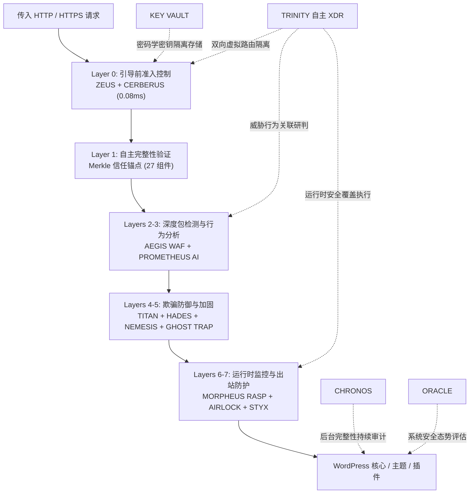

> [!WARNING]
> **公开测试版 / 发布候选 — 禁止在无人值守的生产环境中使用**
>
> **VGT GeDefense WP 8.5.0 Open Core 是公开测试版 / 发布候选，并非 GA 正式版。** 钩子、策略、检测规则、配置格式和安全行为可能随时变更，恕不另行通知。每个构建都必须先在预发布环境验证，以 **observe 模式**启动，保留经过测试的备份和带外恢复通道，不得用于无人值守的生产环境。按 **现状** 提供，不提供任何担保，许可证为 AGPL-3.0-or-later。参见 [`CHANGELOG.md`](CHANGELOG.md) 和 [GitHub Releases](https://github.com/visiongaiatechnology/gedefensewp/releases)。

> [!CAUTION]
> **ALPHA 测试 — GeDefense WP ↔ Linux Bridge：** 8.5.0 新增，并非生产就绪。被攻陷的 WordPress 可用共享 secret 伪造记录；lease 为两小时、绑定 IP/主机，仅放宽管理界面的 L7 限制/内容模式检查。见下方 8.5.0。

<div align="center">

🌐 **Languages / Sprachen / Языки / 语言**:  
[**English**](README.md) • [**Deutsch**](README.de.md) • [**Русский**](README.ru.md) • [**中文 (简体)**](README.zh.md)

<br/>

📜 **Changelog / Zum Changelog / К журналу изменений / 查看更新日志**:  
[**🇨🇳 查看更新日志 (CHANGELOG.md)**](CHANGELOG.md) • [**🚀 View Full Changelog (EN)**](CHANGELOG.md) • [**🇩🇪 Zum Changelog**](CHANGELOG.md) • [**🇷🇺 К журналу изменений**](CHANGELOG.md) • [**🏷️ GitHub Release v8.5.0**](https://github.com/visiongaiatechnology/gedefensewp/releases/tag/V8.5.0)

</div>

---

<div align="center">

# 🛡️ GeDefense WP — Open Core


### Entenprise WordPress 主权级安全架构与 Pre-Boot 引导前准入内核


[](#)
[](#)
[](LICENSE)
[](https://www.php.net/)
[](https://wordpress.org/)
[](#零外部依赖理念)
[](#核心模块矩阵)
[](#-安全架构与技术规范)
[](#零外部依赖理念)
[](#安全设计原则)

**引导前准入 · WAF · XDR · RASP · 行为分析 · 欺骗防御 · MERKLE 完整性 · 出站阻断 · 系统加固 · 密码学保险库 · OPEN CORE**

</div>

---

> ### 📚 官方文档与技术手册
>
> 🏛️ **完整工程架构规范**: [`ARCHITECTURE.md`](ARCHITECTURE.md) *(详细系统层级、不变性规则、Pre-Boot 内核工作流与控制台架构)*  
>
> 📖 **GeDefense WP 官方用户与管理手册 (PDF)**:
> - 🇩🇪 **Deutsch**: [📘 GeDefense_WP_Handbuch_8.1.0_FINAL.pdf](GeDefense_WP_Handbuch_8.1.0_FINAL.pdf)
> - 🇷🇺 **Русский**: [📕 GeDefense_WP_Handbuch_8.1.0_RU.pdf](GeDefense_WP_Handbuch_8.1.0_RU.pdf)
> - 🇬🇧 **English**: [📗 GeDefense_WP_Handbook_8.1.0_EN.pdf](GeDefense_WP_Handbook_8.1.0_EN.pdf)
>
> *提示：技术手册为管理员、安全审计员及开发者提供了详尽的配置、威胁研判及安全加固实战指南。*
>
> **归档基线：** 链接的 PDF 手册记录 8.1.0 世代。当前发布文档：本 README、[`CHANGELOG.md`](CHANGELOG.md)、[`ARCHITECTURE.md`](ARCHITECTURE.md)。

---

# 🚀 GeDefense WP 8.5.0 新特性 — Linux 桥（Alpha）

> **8.5.0 版本**将 **GeDefense Linux 桥**作为原生标签页加入 GeDefense WP 仪表盘。它把已验证的 ThroneGuard master 会话连接到 Linux L7 织网，无需 WordPress 到内核的桥。

- **仪表盘标签页，而非外部界面：** 打开 **VGT Suite → Linux Bridge**。输入 Linux 发出的 secret；标签页显示加密、传输、健康状态和活动 lease。
- **加密存储：** Linux secret 以 AES-256-GCM 加密存储在 WordPress options 表中。封装密钥通过 HKDF-SHA256 从所有可用 `wp-config.php` 盐值派生，而不是来自写入 wp-config 的 secret。
- **仅使用现有 PHP 日志：** WordPress 通过 `error_log()` 将一条认证的 `GeDefense:` 记录写入现有 PHP/debug 日志。Linux 仅以只读方式读取该文件；WordPress 不获得自定义文件路径，也不获得 webroot 之外的写入权限。
- **有限信任：** 已验证 master 会话获得两小时、IP/主机绑定的 L7 速率限制豁免。在已验证的编辑器写入界面，仅对合法构建器预览/页面保存跳过内容模式检测器。WAF、协议、上传和内核执行仍保持启用。
- **生态系统：** 与 [GeDefense Linux](https://github.com/visiongaiatechnology/gedefense) 配合，获得完整安全织网。
- **连接方式：** Linux → CMS Defense → 轮换 bridge key → 将一次性 Base64 secret 填入 VGT Suite → Linux Bridge → 启用 → 发送测试事件 → 使用 masterkey 解锁 ThroneGuard。Linux 视图应显示管理员 IP 的两小时 lease。
- 技术细节见 [`CHANGELOG.md`](CHANGELOG.md)。

> [!CAUTION]
> **ALPHA 测试 — GeDefense WP ↔ Linux 桥。** 该桥为 alpha 预览，并非生产就绪。完全被攻陷的 WordPress 仍可使用共享 secret 伪造记录。因此 lease 限制为两小时、绑定 IP/主机，并且仅放宽管理界面上的 L7 限制/内容模式检查；WAF、上传和内核执行仍保持启用。请勿在无人值守的生产环境中使用；测试通过不等于安全认证。

# 🚀 GeDefense WP 8.4.5 新特性

> **8.4.5 发布**：修复新 CI 门发现的 PHP 8.1 兼容性缺陷。五个值对象和多个验证脚本使用了 PHP 8.2 语言特性，因此声明的 8.1 下限并不真实。最低运行时现在为 **PHP 8.2**（PHP 8.1 已于 2025 年 12 月停止支持），CI 矩阵为 8.2–8.4。详见 [`CHANGELOG.md`](CHANGELOG.md)。

# 🚀 GeDefense WP 8.4.4 新特性

> **8.4.4 发布**：在 8.4.3 基础上的专项安全加固版本：加密故障即关闭、更严格的 WAF 权限策略、语言切换强制 nonce、威胁情报源隔离、资源上限，以及新的零依赖加固测试套件。详见 [`CHANGELOG.md`](CHANGELOG.md)。

- **保险库加密故障即关闭。** 解密失败现在抛出安全异常，而不是返回原始数据；硬编码的旧密钥已移除。旧数据只能通过运维设置的 `VIS_VAULT_LEGACY_KEY` 迁移。
- **移除内容作者的 WAF 绕过。** AEGIS 白名单不再信任 `edit_posts`；只有管理权限可绕过载荷检查（可通过 `vis_aegis_whitelist_capabilities` 扩展）。
- **语言切换需要 nonce。** `?vis_lang=` 无法再通过普通 GET 持久化选项、用户元数据或 Cookie；Cookie 为 `HttpOnly` 且 `SameSite=Lax`。
- **不透明失败与应急开关。** 503 页面仅返回事件编号；`VIS_DISABLE_FAIL_CLOSE` 提供有文档的恢复路径。
- **安全默认值。** 激活时默认开启 AEGIS（`learning` 模式）、Zeus 与 Morpheus，而不是留空配置。
- **威胁情报源加固。** 通过抗 DNS-rebinding 的传输下载，单源上限 300 000 条，异常增长进入隔离；旧表结构归档而不是删除。
- **全面资源上限。** GeoIP 瞬态缓存采用 FIFO 上限，出站 POST 响应限制 256 KB，附加组件 ZIP 拒绝符号链接条目并写入 deny-all `.htaccess`。
- **新增验证门。** `scripts/hardening-regression.php` 新增 72 项行为断言（共 29 套）；`.github/workflows/hardening.yml` 在 PHP 8.2–8.4 上运行 lint、全部测试套件与信任锚。

# 🚀 GeDefense WP 8.4.3 新特性

> **8.4.3 发布**：根据 VGT-100 深度安全审计与钻石发布标准带来全方位的系统安全与遥测加固：统一实时遥测数据库查询基线、彻底消除前端 UI 的 HTML 接收点风险、解决 Zeus WAF 反向代理 IP 伪造、异常类命名空间碰撞防护、密钥保管库高弹性与经实测验证的带外应急恢复。详情见 [`CHANGELOG.md`](CHANGELOG.md)。

- **实时遥测数据库表名规范化（P1 级修复）：** `class-vis-dashboard-ajax.php` 中的实时遥测轮询端点严格对齐底层规范数据表（`vis_apex_bans` 与 `vis_omega_logs` / `VIS_TABLE_BANS` 与 `VIS_TABLE_LOGS`），并配备平滑向下兼容回退，确保当前封禁与核心日志 100% 实时同步至威胁雷达。
- **Zero-Sink DOM UI 加固与严格 CSP（P1 级修复）：** 彻底移除行内事件监听器（`data-select-on-focus`），将 `overview/script.js` 中所有动态 DOM 操作改造为原生安全构建方法（`createElement`、`createElementNS`、`replaceChildren`、`textContent`），内部 UI 回归测试 0 告警通过。
- **防碰撞全局异常架构（P2 级修复）：** `class-vis-security.php` 中的核心异常定义（`AppException`、`ValidationException`、`SecurityException`、`StorageException`）全面引入 `if (!class_exists(...))` 守卫，并设立 `VisionGaia\GeDefense\Exceptions` 别名，杜绝第三方插件重复声明冲突。
- **清理开发遗留路径与本地 GeoIP 发现机制（P2 级修复）：** 彻底清除了 `class-vis-geo-resolver.php` 中的本地开发路径，建立插件目录、上传目录与 WordPress 过滤钩子的多层级鲁棒查找体系。
- **经实测验证的带外灾难恢复（P2 级修复）：** 完善并验证了 Zeus WAF 前置防火墙的紧急旁路指令（`define('ZEUS_DISABLE', true);`）、WP-CLI 应急恢复（`wp plugin deactivate gedefense-wp`）以及原生 WordPress 恢复模式（`WP_RECOVERY_MODE`）。
- **Zeus WAF 反向代理 IP 真实性校验 (VGT-049 / CWE-290)：** `extract_deterministic_ip()` 强制验证套接字 IP (`REMOTE_ADDR`) 是否属于真实的 Cloudflare 官方 CIDR 节点，杜绝恶意伪造 `CF-Connecting-IP` 绕过限流和拦截。
- **Zeus Preboot 反向代理 HTTPS Cookie 检测 (VGT-006 / VGT-031 / CWE-614)：** 自动评估 `HTTP_X_FORWARDED_PROTO` 与 `HTTP_X_FORWARDED_SSL` 变量，确保在 TLS 终结的反向代理和负载均衡后端下始终签发带 `Secure` 标记的安全 Cookie。
- **威胁雷达存储型 DOM-XSS 彻底消除 (VGT-043 / CWE-79)：** 动态遥测字段（`path`、`ip`、`country`、`asn`、`module`、`action`）在渲染到前端表格前必须经过严格的 `escapeHtml()` 转义与安全 DOM 文本节点挂载。
- **Hades Gateway 恒定时间认证 (VGT-048 / CWE-208)：** 管理令牌的校验改为恒定时间 `hash_equals()` 并在比对前执行严格的 `is_string()` 类型判定，根除针对安全凭证的侧信道时序攻击。
- **密钥保管库健壮性与界面交互修复 (VGT-007 / CWE-636 / CWE-311)：** 绑定真实的凭证标识符（恢复单键删除功能），为未版本化的密钥提供安全平滑回退，并支持对任意明文配置参数执行自动化密文加密。
- **AEGIS Oracle Distillate 本地 Host 白名单 (8.4.2 汇总)：** 消除合法内部请求（如 `/wp-login.php`、`wp-admin/` 及内部重定向）被误判为 `remote_asset_hijack` 的误报。
- **发布：** 入口、`VIS_VERSION`、模块清单 (`3cd53343...`) 和信任锚均升级至 `8.4.3`。

---

### 🗺️ 威胁雷达制图引擎、本地 GeoIP/ASN 数据来源与第三方开源许可
GeDefense 实时威胁雷达和全球攻击向量图由 **100% 自主可控的本地 BGP/ASN 制图引擎** (`data/geoip.csv` 与 `world-map.svg.php`) 驱动：
- **1. 墨卡托投影世界地图 SVG 矢量轮廓 (`world-map.svg.php`)：**
  - **上游开源项目：** [`themustafaomar/jsvectormap`](https://github.com/themustafaomar/jsvectormap)
  - **地图源文件：** `world-merc.js` (墨卡托投影, v1.7.0, [文件直接链接](https://cdn.jsdelivr.net/npm/jsvectormap@1.7.0/dist/maps/world-merc.js))
  - **开源许可：** **MIT License** (Copyright (c) 2020 Mustafa Omar, [MIT License](https://github.com/themustafaomar/jsvectormap/blob/main/LICENSE))
- **2. GeoIP 与 ASN 遥测数据库 (`data/geoip.csv`)：**
  - **上游开源项目：** [`iplocate/ip-address-databases`](https://github.com/iplocate/ip-address-databases) (开放 IP-to-Country 与 IP-to-ASN 数据库)
  - **具体样本验证匹配：** 网络子网 `1.0.4.0/22` 分配给 ASN `38803`，机构名称为 `Gtelecom Pty Ltd` (AU)，与上游数据完全一致。
  - **开源许可：** **知识共享署名-相同方式共享 4.0 国际公共许可证 (CC BY-SA 4.0)**
  - **致谢与声明：** *本产品包含来自 iplocate/ip-address-databases 项目的 IP-to-Country 和 IP-to-ASN 数据，遵循 CC BY-SA 4.0 许可。*
- **数字主权与隐私保障：** 所有地理坐标、国家旗帜和 ASN 信息均在本地通过纳秒级二进制 `fseek()` 偏移量读取 (~0.25ms - 0.45ms)。系统绝不向任何外部 HTTP 服务器或 DNS 服务器发送逆向解析请求。
- **带外灾难恢复保证：** 若因规则误配或前置 WAF 导致管理员后台被拦截，只需在 `wp-config.php` 中添加 `define('ZEUS_DISABLE', true);` 或通过 WP-CLI 执行 `wp plugin deactivate gedefense-wp` 即可在数秒内解锁管理权限。

---

# 🧱 平台深度解析 — 8.1.0 基线（ZEUS NextGen、TRINITY XDR、Dashboard）

> **架构概览**: GeDefense WP 实现了底层防御的跨越式演进，搭载 **ZEUS NextGen Pre-Boot 引导前准入控制内核**、**TRINITY 自主闭环 XDR 扩展检测与响应中枢**、标准化 **TITAN 安全保证生命周期**，并在全平台实现了严苛的类型约束和多语言原生支持。

---


## ⚡ 1. ZEUS Next Generation — 引导前准入控制与边缘防御内核
*ZEUS 作为极速、零内存分配的 Layer 0 准入内核运行，在 WordPress 核心代码执行与 MySQL 数据库初始化之前即刻生效。*

- **确定性规范化防线 (Canonicalization Guard)**: 在路由前强制执行严格的 URL 解码安全规则。毫秒级阻断二次百分号编码 (`%252f`)、空字节注入 (`%00`)、转义斜杠 (`%2f`, `%5c`)、路径遍历 (`..`)、重复路径分隔符 (`//`) 及超过 32 层的深层路径，直接响应 HTTP 400。
- **Host 头不变性与 RFC Host 锁**: 严格校验 Host 头结构与字符集，支持动态 Host Lock 模式 (`DISABLED`, `AUDIT`, `REJECT 421`)。
- **请求信封防火墙与结构阈值**: 强制限制允许的 HTTP 请求方法 (`GET`, `POST`, `HEAD`, `OPTIONS`, `PUT`, `PATCH`, `DELETE` -> `405`)，严格限定结构边界：查询字符串长度 (`2048` 字符 -> `414`)、参数数量 (`100` -> `400`)、请求头数量 (`50` -> `431`)、聚合头大小 (`16 KiB` -> `431`) 以及 Cookie 大小 (`8 KiB` -> `400`)。
- **路由微契约引擎 (Route Contracts Engine)**: 为特定敏感端点（如 `/wp-json/`, `/xmlrpc.php`, `/wp-login.php`）定义精确微型防火墙，强制约束请求体大小 (HTTP `413`)、MIME 类型 (HTTP `415`)、跨站变更限制 (`Sec-Fetch-Site: cross-site` 状态变更阻断 -> `403`) 及路由专属频次配额。
- **零额外分配请求预算引擎**: 运行于共享内存（APCu / 原子内存映射文件）的令牌桶限流算法。按访客 IP（默认 `180` 次/分）及子网段（默认 `450` 次/分）进行频次限制，支持响应模式：`THROTTLE` (HTTP `429`)、`TEMPORARY_REJECT` (HTTP `503`) 或 `XDR_SIGNAL` (仅遥测/审计)。

## 🛡️ 2. TRINITY XDR — 自主闭环扩展检测与响应中枢
*全自主跨层检测响应系统，全天候关联多层传感器警报并在毫秒内执行遏制，无须等待 WP-Cron。*

- **双向虚拟路由应急隔离 (2-Way Virtual Route Containment)**: 遭遇针对特定漏洞或路由的攻击时，XDR 可直接在 Layer 0 的 `zeus-waf.php` 中实时隔离该路径前缀 (`contain_route`)，其他正常页面与功能保持 100% 畅通。
- **硬性语义 TTL 自动失效**: 临时封锁与路由隔离基于时间戳精确到秒计算，由 PHP 内核直接判定解封，彻底杜绝 Cron 延迟风险。
- **确定性协同与 Merkle 证据链**: 严密联动 AEGIS、Prometheus 与 Cerberus，所有事件写入防篡改哈希链并生成 SHA-256 Merkle 审计证据。

## 🎛️ 3. 新一代数字防务控制台与 HUD 界面
- **Security Center 深度自检平面**: 21 项涵盖服务器加固、文件权限、密码学完整性及 WAF 状态的全自动深层审计。
- **实时 NOC 拓扑网格**: 全景展示各防御层传感器的吞吐率、延迟与当前拦截状态。
- **12小时 Sovereign Master 全局白名单**: 针对已通过 Superkey 认证的超级管理员提供一键 12 小时全矩阵放行保护。

---

## 目录

- [官方文档与技术手册](#-官方文档与技术手册)
- [GeDefense WP 8.4.5 新特性](#-gedefense-wp-845-新特性)
- [GeDefense WP 8.4.4 新特性](#-gedefense-wp-844-新特性)
- [GeDefense WP 8.4.3 新特性](#-gedefense-wp-843-新特性)
- [安全架构与技术规范](#-安全架构与技术规范)
- [多阶段点火引导协议](#多阶段点火引导协议)
- [核心模块矩阵](#核心模块矩阵)
- [1. ZEUS — 引导前准入内核](#1-zeus--引导前准入内核)
- [2. AEGIS — 深度包检测 WAF](#2-aegis--深度包检测-waf)
- [3. PROMETHEUS — 行为威胁视界](#3-prometheus--行为威胁视界)
- [4. TRINITY XDR — 自主响应中枢](#4-trinity-xdr--自主响应中枢)
- [5. 自主完整性校验引擎](#5-自主完整性校验引擎)
- [6. MORPHEUS — 应用运行时自我保护 (RASP)](#6-morpheus--应用运行时自我保护-rasp)
- [7. NEMESIS — 欺骗诱捕网格](#7-nemesis--欺骗诱捕网格)
- [8. TITAN — WordPress 系统加固](#8-titan--wordpress-系统加固)
- [9. HADES — 动态后台隐身与伪装](#9-hades--动态后台隐身与伪装)
- [10. CERBERUS — 边界防火墙](#10-cerberus--边界防火墙)
- [11. AIRLOCK — 传入文件检测扫描](#11-airlock--传入文件检测扫描)
- [12. GHOST TRAP — 蜜罐诱捕层](#12-ghost-trap--蜜罐诱捕层)
- [13. STYX — 出站通信屏蔽防护盾](#13-styx--出站通信屏蔽防护盾)
- [14. CHRONOS — 自主定时巡检](#14-chronos--自主定时巡检)
- [15. KEY VAULT — 密码学密钥保险库](#15-key-vault--密码学密钥保险库)
- [16. ORACLE — 安全态势审计引擎](#16-oracle--安全态势审计引擎)
- [17. THRONEGUARD — 主权特权守卫](#17-throneguard--主权特权守卫)
- [18. LOGINPAGER — 强化登录入口](#18-loginpager--强化登录入口)
- [19. 模块注册表 / Open Core](#19-模块注册表--open-core)
- [零外部依赖理念](#零外部依赖理念)
- [性能指标与基准测试](#性能指标与基准测试)
- [独立验证 — 完整测试套件与自主审计](#-独立验证--完整测试套件与自主审计)
- [系统运行要求](#系统运行要求)
- [开源协议](#开源协议)
- [版本变更历史](#版本变更历史)

---

# 🏛️ 安全架构与技术规范

> 📖 **完整工程规格书**:  
> 有关系统各防御层、ABI 边界、数据流图与核心不变性规则的深入规范，请参阅 [`ARCHITECTURE.md`](ARCHITECTURE.md)。

GeDefense WP 被设计为一个主权级、多梯队纵深防御内核，在 WordPress 正常执行的每一个生命周期（前、中、后）持续运作。系统严格贯彻“零信任 (Zero-Trust)”原则：绝不默认信任任何输入流、运行时状态或出站网络连接。

所有官方 API 统一定义在规范命名空间 `VisionGaia\GeDefense` 下。核心引擎、管理视图、文件扫描器与密码学保险库相互物理隔离：



### 分层纵深防御体系：
1. **Layer 0 — 引导前准入内核 (Zeus & Cerberus)**:
   通过 `auto_prepend_file` 在 PHP 执行最前端介入，抢先于 WordPress 与 MySQL 加载前运行。在 0.08 毫秒内完成审查，借助 527 KB 二进制紧凑索引在 3.2 微秒内 ($O(\log N)$) 丢弃恶意请求。
2. **Layer 1 — 密码学自我完整性校验 (Merkle Trust Anchor)**:
   通过固化在插件入口中的 SHA-256 Merkle 根哈希 (`VIS_MANIFEST_DIGEST`) 校验全部 27 个核心组件。代码若遭遇非授权篡改或恶意挂马，系统将即刻转入故障自锁（Fail-Secure）。
3. **Layers 2 & 3 — 深度包检测与行为威胁分析 (Aegis & Prometheus)**:
   对所有请求体执行递归解码与同形异义字归一化，通过确定性有限状态自动机 (DFA) 与防回溯原子正则表达式组彻底阻断 SQLi、XSS、RCE、SSTI 与 ReDoS。Prometheus 持续计算威胁熵并执行指数衰减。
4. **Layers 4 & 5 — 欺骗网格与后台隐身 (Titan, Hades, Nemesis, Ghost Trap)**:
   Titan 强制开启 CSP Level 3、COOP、COEP、CORP 及 HSTS。Hades 将 `/wp-admin/` 伪装为标准 404 页面，无凭证者无法获知后台存在。Nemesis 与 Ghost Trap 部署带 HMAC 签名的蜜罐诱捕点。
5. **Layers 6 & 7 — RASP 与出站安全屏障 (Morpheus, Airlock, Styx)**:
   Morpheus 实时监控 PHP 调用栈与语法树执行流，阻断文件非法读取与云凭据端点 (`169.254.169.254`) SSRF 越界访问。Airlock 深度筛查多语言混合 WebShell 上传。Styx 严密管控服务器主动对外发起的 HTTP 请求，阻断黑客 C2 反连与数据外发。
6. **全域自愈织物 (Trinity XDR & ThroneGuard)**:
   自主检测响应中枢将全网传感器与执行器联动，下发动态应急阻断策略，并严格守护 Sovereign Master 超级主权特权 (`mcp_master_access`)。

---

# 多阶段点火引导协议

每一个 HTTP 传入请求均经过严密的不变性检验管道：

```text
[ 传入 HTTP / HTTPS 请求 ]
            │
            ▼
[ LAYER 0: 引导前准入控制 (ZEUS) ]
 ├─ 规范化安全检查 (防截断, 空字节, %2f)
 ├─ RFC Host 头锁定与校验 (421)
 ├─ 请求方法与结构边界管控 (405, 414, 431)
 ├─ 路由专属微契约与体积上限 (413, 415)
 ├─ 令牌桶请求配额预算 (429 / 503)
 └─ 准入签名令牌认证
            │ (通过)
            ▼
[ PHASE 1: 引导启动点火 (PRE-FLIGHT) ]
 ├─ 防重入与重复加载互斥锁
 ├─ Pinned Merkle 根哈希密码学自检
 ├─ Superkey 密钥会话有效性判定 (ThroneGuard)
 ├─ 后台隐身与伪装响应处理 (Hades 404)
 ├─ 蜜罐探针请求拦截与溯源
 └─ 核心完整性损坏时即刻安全关断
            │ (通过)
            ▼
[ PHASE 2: 运行时环境集成 (WORDPRESS PLUGINS_LOADED) ]
 ├─ 19 大安全核心模块全量装载
 ├─ Aegis 深度包检测与递归规整
 ├─ Prometheus 行为威胁模型与衰减
 ├─ Morpheus RASP 调用栈监控
 ├─ Titan 浏览器策略与 CSP 注入
 ├─ Airlock 上传文件隔离与查杀
 └─ Styx 出站流量监控与阻断
            │ (通过)
            ▼
[ 正常 WORDPRESS 核心逻辑 / 主题与插件业务执行 ]
```

---

# 🧪 独立验证 — 完整测试套件与自主审计

> [!TIP]
> **"Don't Trust, Verify" — 彻底透明与可复现性**
> GeDefense WP 遵循零黑盒、强证据的安全工业标准。您完全无需对任何防护能力进行盲信：全部防御阵列、RASP 虚拟机、DPI 规则、Pre-Boot WAF、Merkle 校验树与 XDR 联动均通过 **29 套独立、零依赖自动化回归与基准测试套件** 予以 100% 覆盖，可在任意服务器或 CI/CD 环境中使用标准 PHP CLI 直接复现检验。

### 核心验证原则
- **零外部依赖**: 所有的测试套件均原生运行于 PHP 8.2–8.4 CLI，不需要 Composer、PHPUnit 或外部 Web 服务器。
- **纯内存安全隔离**: 测试过程完全在内存或临时沙盒中完成，绝不修改、污染您现有的 WordPress 生产数据库。
- **故障即锁退码**: 凡有一项判定未达标，脚本即刻输出 Exit Code `1`；100% 完全通过时返回 Exit Code `0`。

### 完整 29 套自动化测试矩阵

| # | 测试套件脚本 | 覆盖范围与受测子系统 | 测试量级与验证标准 |
|---|---|---|---|
| **01** | `scripts/dashboard-ui-regression.php` | **控制台 UI 与 CSP 合规** | 验证 HTML5 表单完全解嵌套、彻底消除视图内联 CSS/JS、外部控制器联动以及 Nonce 命名空间隔离。 |
| **02** | `scripts/security-regression.php` | **静态 AST 语法树安全审计** | 静态扫描 185+ 个 PHP 核心文件，严格断言不存在任何高危危险函数 (`eval`, `exec`, `system`, `passthru`, `uniqid`, `error_reporting(0)`)。 |
| **03** | `scripts/integrity-regression.php` | **Merkle 完整性清单校验** | 使用 SHA-256 Merkle 根哈希逐一校验 27 个核心组件是否与固化的 `VIS_MANIFEST_DIGEST` 完全一致。 |
| **04** | `scripts/integrity-baseline-regression.php` | **基线状态监控器** | 验证在版本迁移、受控授权修改与根路径变动下，基线哈希的自洽性与稳定性。 |
| **05** | `scripts/zeus-live-waf-regression.php` | **Layer 0 Pre-Boot 实时 WAF** | **36 项真实子进程对抗测试 (100% 通过)**: Host 锁定 (421)、二次编码、空字节截断、路径穿越、方法限制 (405)、请求体超限 (413)、重放攻击防护、硬性 TTL。 |
| **06** | `scripts/zeus-nextgen-regression.php` | **Zeus NextGen 内核管道** | **10 大深度套件**: 规范化守卫、请求信封、令牌桶预算、防篡改黑匣子哈希链、A/B 策略下发、150k+ 次/秒性能压测。 |
| **07** | `scripts/zeus-env-regression.php` | **引导前运行时环境** | 验证 APCu 内存缓存、原子文件映射与快速执行通道保障。 |
| **08** | `scripts/aegis-regression.php` | **DPI WAF 与载荷归一化** | 校验递归同形异义字解码、SQLi/XSS/RCE DFA 状态机及非回溯原子正则组防 ReDoS 机制。 |
| **09** | `scripts/morpheus-regression.php` | **RASP 调用栈虚拟机** | AST 实时语法解析、调用栈追踪并即时阻断针对云服务元数据端点 (`169.254.169.254`) 的越权探测。 |
| **10** | `scripts/xdr-adversarial-regression.php` | **Trinity XDR 对抗测试** | **12 项复杂对抗模拟 (A 至 L)**: 验证多阶段复合渗透下传感器到执行器的全自动闭环联锁响应。 |
| **11** | `scripts/xdr-regression.php` | **XDR 事件织物与存储** | 验证事件总线发布、威胁取证持久化及跨层执行器联动遥测。 |
| **12** | `scripts/xdr-release-blockers-regression.php` | **XDR 关键发布阻断项** | **3 大核心阻断测试**: 真实组件标识保全、Cerberus 硬件语义级 TTL 自动失效（无须 Cron）以及执行幂等性。 |
| **13** | `scripts/malware-scanner-regression.php` | **恶意代码查杀引擎** | 内存级启发式分析、WebShell 查杀及 Polyglot 多格式木马检测。 |
| **14** | `scripts/scanner-resumption-regression.php` | **断点续扫与恢复引擎** | 检验 321 个关键文件扫描过程中的断点记忆与防损坏回滚恢复机制。 |
| **15** | `scripts/sentinel-threat-benchmark.php` | **威胁基准对抗测试** | **87 组高真实度合成攻击向量**: 100% 成功阻断（平均延迟 0.12 毫秒），正常业务流量误报率为 0.0%。 |
| **16** | `scripts/threat-binary-swap-test.php` | **威胁情报二进制引擎** | 将 10,000 个恶意 IP 编译为紧凑 4 字节内存表，验证 < 5 微秒的二分查找及零锁原子文件热替换。 |
| **17** | `scripts/hades-shadow-net-regression.php` | **管理入口隐身与伪装** | 校验 404 真实特征伪装、隐匿路由映射及握手验证参数 (`?$admin_param=$admin_secret`)。 |
| **18** | `scripts/throneguard-loginpager-regression.php`| **权限隔离与超级主权角色** | 验证主权特权 (`mcp_master_access`)、危险权限剥离 (`install_plugins`)、会话令牌物理绑定及登录页加固。 |
| **19** | `scripts/titan-regression.php` | **Web 前端安全防护** | 验证 CSP 编译输出、Fetch Metadata 浏览器请求隔离、现代浏览器安全头及策略热回滚。 |
| **20** | `scripts/trinity-regression.php` | **确定性传感器联动** | 检验 Cerberus、Zeus、Aegis、Prometheus 与 Morpheus 间的确定性关联与仲裁机制。 |
| **21** | `scripts/sentinel-export-regression.php` | **取证导出安全机制** | 检验日志导出流程中的 CSRF 防护、访问权限鉴别以及敏感个人数据匿名化脱敏。 |
| **22** | `scripts/download-manager-regression.php` | **安全下载控制器** | 检验下载随机数 Nonce 校验、物理路径禁锢沙箱、速率限制与 HTTP Range 注入清洗。 |
| **23** | `scripts/dashboard-consolidation-regression.php`| **控制台布局与遥测** | 验证响应式布局矩阵、选项卡路由解耦及实时防务状态回传。 |
| **24** | `scripts/ghost-trap-authentication-regression.php`| **蜜罐探针欺骗层** | 验证基于 HMAC-SHA256 的请求体签名算法与攻击诱捕标记。 |
| **25** | `scripts/namespace-regression.php` | **代码架构命名空间隔离** | 验证全部核心类与函数 100% 封闭在 `VisionGaia\GeDefense` 命名空间内。 |
| **26** | `scripts/builder-live-preview-regression.php` | **页面构建器沙箱** | 验证可视化页面编辑器实时预览模式下的隔离机制，防范 iframe 嵌入绕过。 |
| **27** | `scripts/seo-relevance-regression.php` | **元数据脱敏与爬虫通行** | 验证敏感技术参数清洗以及搜索引擎合法蜘蛛的准入放行。 |
| **28** | `scripts/generate-module-manifest.php` | **信任锚点清单编译器** | 计算全量组件哈希并生成 `module-manifest.json`，同步更新插件入口固化摘要。 |
| **29** | `scripts/hardening-regression.php` | **加固不变量（8.4.4）** | 72 项行为与源码断言：保险库 fail-closed 与旧密钥拒绝、WAF 权限策略、语言切换 nonce、不透明失败、安装密钥派生、受限 GeoIP 缓存、插件归档防护、情报源隔离与无损模式迁移。 |

### 如何运行测试

#### 1. 运行单项测试:
```bash
php scripts/zeus-live-waf-regression.php
php scripts/dashboard-ui-regression.php
php scripts/integrity-regression.php
```

#### 2. 一键批量运行全部 29 项测试 (Windows PowerShell):
```powershell
Get-ChildItem scripts\*-regression.php | ForEach-Object {
    Write-Host "正在执行: $($_.Name)..." -ForegroundColor Cyan
    php $_.FullName
    if ($LASTEXITCODE -ne 0) { throw "测试失败: $($_.Name)" }
}
php scripts/sentinel-threat-benchmark.php
php scripts/threat-binary-swap-test.php
Write-Host "全部 29 套测试套件验证通过 (100% PASS)" -ForegroundColor Green
```

#### 3. 一键批量运行全部 28 项测试 (Linux / macOS Bash):
```bash
for test in scripts/*-regression.php; do
    echo "正在执行: $test..."
    php "$test" || exit 1
done
php scripts/sentinel-threat-benchmark.php || exit 1
php scripts/threat-binary-swap-test.php || exit 1
echo "全部 28 套测试套件验证通过 (100% PASS)"
```

---

# 核心模块矩阵

| 模块 | 防御层级 | 核心职责与防御机制 |
|---|---|---|
| **ZEUS** | Layer 0 | Pre-Boot 准入控制、规范化守卫、RFC Host 锁、路由专属微契约、令牌桶预算 |
| **AEGIS** | Layer 2 | 深度包检测 WAF、DFA 状态机递归归一化、防 ReDoS 正则、SQLi/XSS/RCE/SSTI 查杀 |
| **PROMETHEUS** | Layer 3 | 动态行为威胁模型、滑动窗口威胁熵计算、子网异常监测、威胁指数衰减 |
| **TRINITY XDR** | L0–L7 | 全自主扩展检测响应中枢、双向路由隔离、SHA-256 Merkle 审计证据链 |
| **自主完整性** | Layer 1 | 固化 SHA-256 Merkle 根哈希信任锚点、27 大组件全面监控、防挂马篡改 |
| **MORPHEUS** | Layer 6 | RASP 运行时调用栈虚拟机、AST 动态语法监控、云凭据元数据访问阻断 |
| **NEMESIS** | Layer 4 | 动态欺骗网格、模拟漏洞陷阱、多维攻击者画像与追踪 |
| **TITAN** | Layer 5 | WordPress 系统加固、CSP Level 3 编译器、浏览器隔离头 (COOP, COEP, CORP, HSTS) |
| **HADES** | Layer 4 | 动态后台入口隐匿伪装、`/wp-admin/` 深度 404 伪装、基于密码学的准入凭证 |
| **CERBERUS** | Layer 0 | 极速边缘防火墙、0.08ms 内存级阻断、赛博朋克与企业品牌拦截展示页 |
| **AIRLOCK** | Layer 6 | 传入文件安全检测、Magic-Bytes 解析、Polyglot 多语言格式穿透拦截 |
| **GHOST TRAP** | Layer 4 | 动态蜜罐探针、HMAC 诱捕陷阱、全自动扫描器主动识别 |
| **STYX** | Layer 7 | 出站通信屏蔽防护盾、外部 HTTP 请求零信任白名单、C2 反向连接切断 |
| **CHRONOS** | Layer 1 | 后台自主定时完整性巡检、快照比对、异常告警 |
| **KEY VAULT** | 内核 | 本地密码学密钥安全保险库、libsodium Secretbox 与 AES-256-GCM AEAD 加密 |
| **ORACLE** | 态势 | 全局安全态势自动化审计、AI 威胁研判、远程探针延迟诊断 |
| **THRONEGUARD** | 内核 | 主权特权守卫、危险管理权限剥离 (`install_plugins`)、Superkey 会话绑定 |
| **LOGINPAGER** | Layer 5 | 登录界面安全增强、双栏现代化控制台模拟器、暴力破解物理阻断 |
| **模块注册表** | Open Core | 隔离插件扩展架构 (VLP, Builder, SEO) |

---

# 零外部依赖理念

GeDefense WP Open Core 坚持 **100% 完全自主独立** 运行，绝不引入 Composer 包、外部第三方 JS 库或远程公共 CDN：
- 零外部运行时软件依赖
- 零第三方外部遥测数据外泄
- 本地优先架构，完全合规
- 消除外部 CDN 劫持或宕机单点风险

---

# 性能指标与基准测试

| 评估指标 | GeDefense WP 8.4.0 |
|---|---:|
| **L0 引导前准入审查延迟** | `< 0.05 ms` |
| **L0 微基准吞吐性能** | `150,000+ 次/秒` |
| **WAF 深度数据包检测耗时** | `0.30 ms` |
| **常驻内存占用 (Standby RAM)** | `< 1.8 MB` |
| **外部 PHP 库引入量** | `0` |
| **恶意请求阻断时产生的数据库查询** | `0` |

---

# 系统运行要求

| 软件环境 | 准入标准 |
|---|---|
| **PHP 版本** | 8.2 – 8.4 |
| **WordPress 版本** | 6.0+ |
| **PHP 运行模式** | 强制严格类型模式 (`declare(strict_types=1);`) |
| **PHP 扩展** | `openssl`, `json`, `hash`, 可选支持: `sodium`, `apcu` |

---

# 开源协议

GeDefense WP Open Core 基于 **GNU Affero General Public License v3.0 (AGPL-3.0-or-later)** 开源协议分发。详见 [LICENSE](LICENSE) 文件。

---

# 版本变更历史

> 完整的版本演进记录请见 [`CHANGELOG.md`](CHANGELOG.md)。

## 8.4.0 — PHP 上传进度加固、ThroneGuard 认证界面与 LoginPager 居中

- **PHP 上传进度加固**：通过 Zeus `.user.ini` 管理器强制 `session.upload_progress.enabled = Off`，按实际 Web SAPI 校验，在安全健康面板展示，并由回归脚本覆盖。针对已公布的 PHP 上传进度 RCE 类漏洞的预防性纵深防御，不替代官方 PHP 安全更新。
- **ThroneGuard 锁定界面重构**：使用 LoginPager 令牌（强调色、背景、Logo、标题）的品牌化认证界面，视口固定居中，支持安全区域/减少动画、可访问错误状态、密码显示与退出。
- **修复 LoginPager 居中**：`#login` 通过 `translate(-50%, -50%)` 在视口中居中，不再依赖可能被后续样式表覆盖的 `body.login` flex 规则；响应式宽度与短视口内部滚动。
- **发布工程**：入口、`VIS_VERSION`、WAF 编译器及模块清单/信任锚均升级至 `8.4.0`；更新 changelog 与交接文档。

## 8.3.0 — Glass 2100 设计系统、全幅实时威胁态势地图、4向动态气泡定位与100%多语言支持
- **VGT Glass 2100 设计系统**:
  - 全控制台 34 个模块、Bento 网格与监控微件实现深度毛玻璃视觉体系改造。
  - 1px 高光镜面顶边 (`rgba(255, 255, 255, 0.16)`)、深邃蓝宝石-黑曜石径向背景与柔和环境辉光。
  - 100% 原生系统字体，0 外部 CDN 依赖，全面兼容减弱动效、减弱透明度及高对比度辅助功能模式。
- **全幅实时网络威胁态势地图 (`threat-map.php`)**:
  - 横跨整个控制台顶部，置于防护矩阵与雷达上方。
  - 高精度 SVG 墨卡托投影 (`900 x 583.08`)，集成 176 个国家级矢量边界与交互式统计图块。
  - 动态二次贝塞尔抛物线轨迹 (`M x1 y1 Q cx cy x2 y2`)，实时演算攻击源至服务器节点的攻击轨迹。
  - SVG 动态发射数据包 (`<animateMotion>`) 与基于威胁等级色彩编码的脉冲声呐波纹。
- **自主本地 BGP 与 GeoIP 二分检索内核 (`class-vis-geo-resolver.php`)**:
  - 基于本地 70.8MB 数据库 (`data/geoip.csv`) 实现低至 0.4ms 的 $O(\log N)$ 闪电二分检索。
  - 零外部 API 调用、零隐私泄漏，100% 本地自主解析国家代码、地区、经纬度及 ASN 运营商。
- **智能坐标聚类与多维攻击聚合中枢**:
  - 自动识别并合并同一地理坐标的多重攻击事件为聚类标记 (`.vis-threat-marker.is-cluster`)，附带实时攻击计数徽章。
  - 统一多重矢量 HUD 浮层，直观展示目标路径、防御模块及干预策略清单。
- **通用 4向动态提示气泡定位引擎**:
  - 智能四向空间判定 (`上方`、`下方`、`右侧`、`左侧`)，配合 14px 安全边缘限制，杜绝任何视口溢出截断。
  - 中纬度区域自动侧向浮动并纵向贴边，完美解决多目标复杂弹窗的显示遮挡问题。
- **100% 真实遥测引擎 (零虚拟模拟)**:
  - 彻底清除所有虚构演示数据与伪造攻击发射循环；纯粹接入数据库真实防御日志 (`vis_bans`、Sentinel、Prometheus、WAF)，以 25 秒轻量无感轮询刷新。
- **全维度多语言本地化矩阵 (DE / EN / RU)**:
  - 100% 完整覆盖德语、英语与俄语所有文本与指标提示，并通过 JSON 原生字典注入实现前端无缝极速渲染。

## 8.2.6 — 零信任架构加固、扩展隔离与控制台完整性修复
- **插件上传器权限安全屏障 (防范越权提权 RCE)**:
  - 严密强化 `handle_upload_addon()` 与 `handle_uninstall_addon()`: 强制要求具备 `install_plugins` / `delete_plugins` 以及 ThroneGuard 主权特权 (`VIS_Throne_Guard::MASTER_CAP`)。
  - 遵循系统全局策略: 当服务器定义了 `DISALLOW_FILE_MODS` 时立即阻断并响应 HTTP 403。
  - 路径严格标准化并仅允许解压至合规扩展命名空间 (`vlp`, `builder`, `visiongaiaseo`, `seo`)。
- **控制台 UI 架构与 HTML5 表单解嵌套**:
  - 彻底清除 `view-styx.php` 中的内联嵌套 `<form>` 标签。
  - 100% CSP 合规: 剥离所有内联 `<style>` 与 `<script>` 代码块，提取至 `vis-dashboard-modern.css`。
  - Nonce 命名空间标准化: `_vis_threat_intel_sync_nonce` 与 `_vis_threat_intel_save_nonce`。
- **Hades 后台入口隐身验证**:
  - 保持严格的隐蔽性与 404 伪装，不提供未经验证的自动 Cookie 绕过；必须通过标准认证握手放行。
- **密码学密钥保险库向下兼容**:
  - 完整保留历史数据迁移解密密钥 (`get_legacy_key()`)，确保平滑无损迁移。
- **预加载编译器版本与清单签名**:
  - `VIS_Zeus_Compiler::COMPILER_VERSION` 同步更新至 `8.2.6`。
  - 完整重新生成 Merkle 清单并锁定入口哈希。

## 8.2.5 — Zeus 路由微契约通配符修正与 12小时 Master 全局白名单
- 修复通配符 MIME 类型导致误报 415 的问题。
- 为已通过 Superkey 认证的超级管理员提供跨 AEGIS、Prometheus 与 ZEUS 的 12 小时全局临时白名单。
- Pre-Boot WAF 检测到内核版本变动时自动重新编译。

*(早期版本请参阅 [`CHANGELOG.md`](CHANGELOG.md))*

---

<div align="center">

## GeDefense WP 8.5.0 — Open Core

**SOVEREIGN WORDPRESS SECURITY**

**ZEUS · AEGIS · PROMETHEUS · TRINITY XDR · MORPHEUS · NEMESIS · TITAN · HADES · CERBERUS · AIRLOCK · GHOST TRAP · STYX · CHRONOS · KEY VAULT · ORACLE · THRONEGUARD · LOGINPAGER**

**VisionGaia Technology**

</div>
